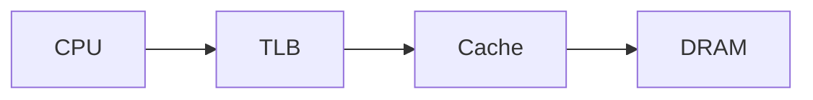

# Spencer Neilan — Systems Coursework

This repository contains the source for my technical blog and living coursework site.

**Website:** [https://spencerbug.github.io](https://spencerbug.github.io)

Current areas of focus include NIC firmware, OpenBMC and platform firmware, performance and cache optimization, embedded and IoT security, trading systems, and embodied AI research.

## Authoring features

The site supports:

- Markdown/Jekyll course pages and blog posts
- persistent light/dark mode
- browser-local course, blog, and research-report review annotations
- a repository-backed course issue board
- Mermaid diagrams
- MathJax equations

## Course issue board

Larger curriculum work is tracked as Markdown tickets in `_issues/` and rendered at [https://spencerbug.github.io/issues/](https://spencerbug.github.io/issues/). Ticket front matter records a stable ID, workflow status, priority, type, area, relative effort, dependencies, labels, and created/updated dates. See [`AGENTS.md`](AGENTS.md) for the schema and workflow rules.

## Review annotations

Course pages include a private, browser-local review system implemented by `assets/annotations.js`. Blog articles, the Reports index, and individual reports use the same workflow through `assets/blog-annotations.js`. Blog keys remain `blog-annotations:v1:<path>`; report keys are `report-annotations:v1:<path>` (with corresponding draft keys). Notes stay isolated by URL.

Each `h2`, `h3`, and `h4` section gets a small 💬 button. Comments are stored in `localStorage` for that lesson URL and are not published to GitHub.

Workflow:

1. Read a lesson.
2. Optionally select the specific text the comment refers to.
3. Tap the 💬 button beside the section heading.
4. Choose a type such as Question, Unclear, Expand, Diagram, Example, Correction, Lab idea, or Note.
5. Add the comment.
6. At the bottom of the page, review unresolved/resolved comments.
7. Use **Copy report** or **Copy prompt + report** and paste the Markdown into ChatGPT.
8. After the course page is updated, mark comments resolved, clear resolved comments, or use **Clear all comments** to start the lesson review over.

The generated report includes the page URL, section heading, stable anchor, optional selected text, comment type, and comment body so an agent can locate the intended material reliably.

Annotations are intentionally local to the current browser/device and are meant as temporary review notes rather than permanent storage.

### Publication checks

Run `python3 scripts/check_inline_mathjax.py` and build with `bundle exec jekyll build`.
For the review controls, `scripts/check_review_annotations.cjs` exercises saved
comments, drafts, selected text, editing, exports, resolution/deletion, URL isolation,
existing blog keys, report navigation, and theme toggling against the built HTML.
It uses jsdom (verified with 31.0.0), installed outside the site:

```sh
npm install --prefix /tmp/soam-publication-tests --no-audit --no-fund jsdom@31.0.0
NODE_PATH=/tmp/soam-publication-tests/node_modules node scripts/check_review_annotations.cjs
```

This is DOM verification, not a browser layout test. Inspect desktop/mobile and
light/dark rendering in a real browser when browser access is available. The E1
figures can be rebuilt with `python3 scripts/render_soam_e1_results.py` in an
environment with matplotlib and numpy; the script verifies the downloaded evidence
hashes and only renders archived estimates. It never runs scientific trials.

### Mermaid diagrams

Use a fenced `mermaid` block:

````markdown

````

Mermaid blocks are converted and rendered client-side by `assets/mermaid.js`.

### MathJax equations

Inline equation:

```text
\( E = mc^2 \)
```

Display equation:

```text
$$
AMAT = T_{L1} + MR_{L1} \left(T_{L2} + MR_{L2} T_{mem}\right)
$$
```

Single-dollar inline delimiters are intentionally not enabled so normal dollar amounts in prose are not interpreted as math.

## Agent guidelines

See [`AGENTS.md`](AGENTS.md) for conventions used when updating coursework, handling review comments, preserving lesson structure, and authoring diagrams and equations.
