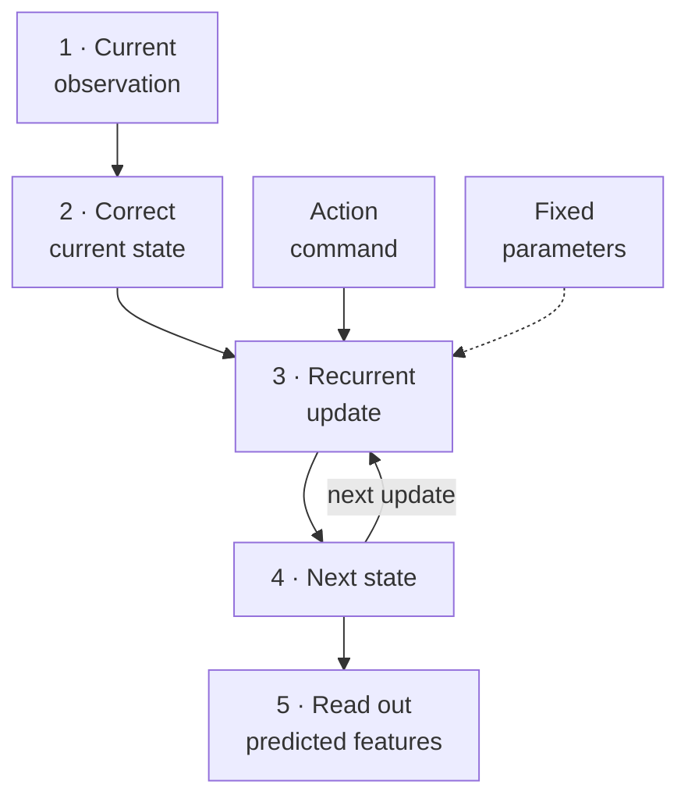
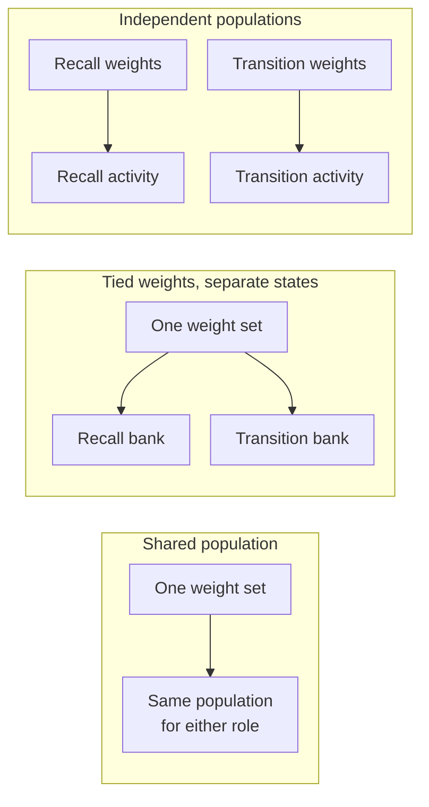
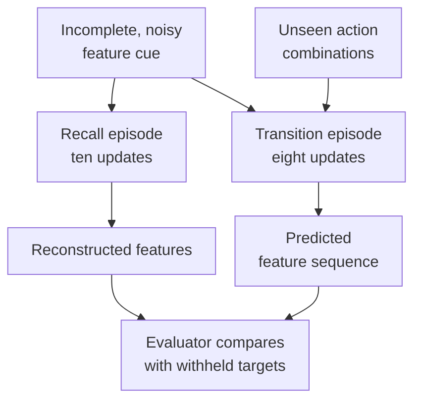
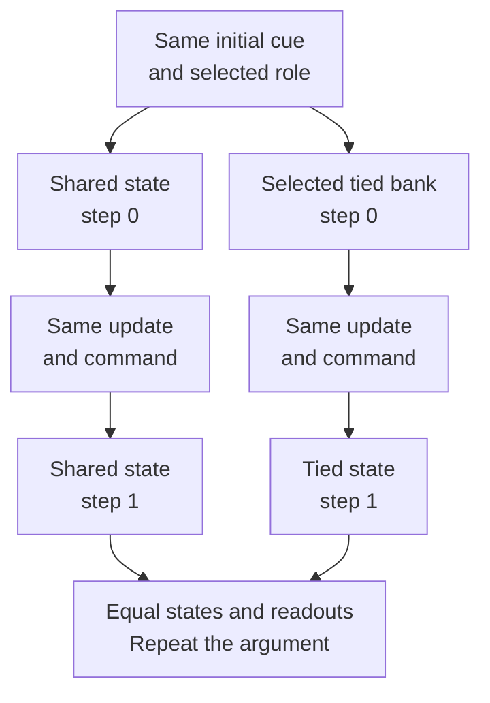
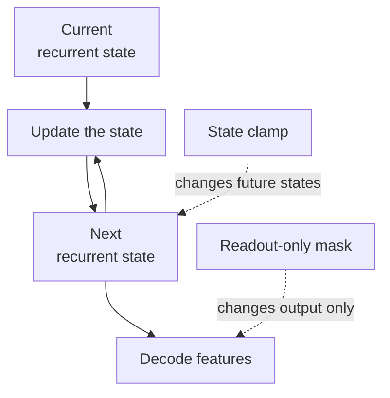



<link rel="stylesheet" href="{{ '/assets/soam-sharing-demo.css' | relative_url }}">

**Research methods · protocol defined, experiments pending.** The diagrams explain the proposed experiment. The interactive example is an untrained toy calculation. No SOAM performance results are presented here. The [companion technical report and frozen protocol downloads]({{ '/research/soam-e1/' | relative_url }}) provide the full experimental context.

In my [introduction to Self-Organizing Attractor Memory]({{ '/blog/self-organizing-attractor-memory/' | relative_url }}), I described a memory that an embodied agent could explore: recover a familiar feature, predict the effect of moving, and eventually reuse learned relationships in new situations.

That picture suggests several responsibilities—features, relationships, actions—but it leaves open how the neural machinery should be organized. One possibility is that overlapping recurrent neurons perform several of these functions. Another is that separate populations exchange information. A third is that separate activity states use the same learned weights.

I want to test the shared-population possibility. Designing the first experiment revealed a useful limitation: **when two tasks run in separate, reset episodes, shared neurons and separate states with tied weights can make exactly the same predictions.**

That changes what a successful experiment would establish. Before building a larger architecture, I need to distinguish useful behavior from evidence about the mechanism producing it.

## Start with weights and state

A recurrent network repeatedly updates an internal activity state. Its **weights** determine the update rule; its **state** contains the activity currently being updated. The same weights can act on many different states, much as one program can operate on several independent workspaces.

In the notation below, `h` is the current state, `a` is an action command, and `θ` denotes the persistent parameters. The function `F` updates the state; `D` reads out a prediction.

$$
h_{t+1}=F_\theta(h_t,a_t), \qquad \hat z_{t+1}=D_\theta(h_{t+1}).
$$

During prediction, the state changes while the parameters stay fixed. Learning would change parameters in a separately controlled operation. This distinction matters whenever we say that a system “shares memory.”

*Figure 1. The loop carries activity forward. A free prediction stops receiving new observations after its initial cue; the feedback loop does not secretly feed in the correct answer.*

Here, a “neuron” means a declared coordinate of the simulated recurrent activity. It is not a claim about a particular biological cell, processor core, or memory address.

## Three ways to organize the same responsibilities

Consider two tasks: reconstructing features from an incomplete cue, and predicting how features change after an action.

| Organization | Persistent parameters | Activity state |
| --- | --- | --- |
| Independent populations | Each task learns its own parameters | Separate state for each task |
| Tied weights, separate states | Both tasks use the same parameters | Separate state for each task |
| Shared population | One parameter set supports both tasks | The same declared recurrent units serve both roles |

*Figure 2. The boxes describe allocation of parameters and activity. In this first experiment, recall and transition happen in separate episodes. The shared box does not imply simultaneous tracking of both tasks.*

Shared parameters can transfer information between tasks during training. Shared recurrent units add a statement about which activity coordinates perform the computation. Putting two independent networks into one large tensor does not, by itself, make their units shared.

The practical appeal is that recall and prediction might help shape a common representation. The corresponding risk is interference: improving transitions could damage reconstruction. Both possibilities belong in the experiment.

## The first task is deliberately small

The initial SOAM pilot uses a point in a two-dimensional simulated world. A fixed projection converts its position into twelve sensory features. The model receives features, masks, a supplied task-role cue, and action commands; it never receives the point's hidden coordinates or the simulator's transition function.

For **recall**, the initial cue contains six noisy feature coordinates. The network gets ten recurrent updates to reconstruct the clean features without another sensory observation.

For **transition prediction**, the point rotates and translates according to a sequence of actions. The network predicts the next eight feature observations from the initial cue and commands alone. Longer predictions and grounded one-step predictions are recorded separately.

*Figure 3. Targets go to the evaluator after prediction. They do not enter the recurrent rollout. The role labels and task structure are supplied scaffolding, not concepts the model has discovered.*

Training and evaluation use different initial phase sectors and different combinations of action bins. This tests generalization within a known transformation family. It does not yet test learning a new object, discovering a relation, or composing independently learned skills.

## The control that can reproduce the shared model

Suppose I train a shared network, then use its weights in two separate state banks. One bank handles recall; the other handles transition episodes. I reset the selected bank and initialize it with exactly the cue that the shared model receives.

At the first step, the active states are equal. Their next updates use the same function, weights, inputs, and task role. Therefore their next states are equal. Repeating that argument gives equal states—and equal predictions—at every step.

$$
h^{\mathrm{shared}}_0=h^{\mathrm{tied}}_0
\quad\Longrightarrow\quad
h^{\mathrm{shared}}_t=h^{\mathrm{tied}}_t

$$

This conclusion assumes deterministic updates, identical initialization and readout, fixed parameters, and no communication with a second active episode. It is a direct consequence of the construction, not a measured SOAM result.

*Figure 4. Inactive banks cannot change this episode's output when there are no cross-bank connections. Matching observations cannot reveal which equivalent realization produced them.*

This is an **identifiability limit**: the chosen observations cannot distinguish the competing explanations. More repetitions of the same kind of trial improve precision, but do not remove that limit.

### Try the equivalence

The illustration below runs a one-dimensional recurrence twice, once for each role, resetting before each episode. “Shared” reuses one state coordinate; “tied” selects one of two independent state slots. Both use the same scalar weights. This toy has no trained memory, sensory targets, or accuracy score.

  

    <label for="sharing-weight">Recurrent weight <output id="sharing-weight-value">0.70</output></label>
    <input id="sharing-weight" type="range" min="-1" max="1.5" step="0.05" value="0.7">
    <label for="sharing-cue">Initial activity <output id="sharing-cue-value">0.60</output></label>
    <input id="sharing-cue" type="range" min="-1" max="1" step="0.05" value="0.6">
  

  
Solid line: shared state. Dashed line: selected tied state. Without intervention, the lines overlap exactly.

  

    <figure><figcaption>Recall episode</figcaption><svg id="sharing-recall" viewBox="0 0 460 230" role="img" aria-label="Recall activity over eight toy updates"></svg></figure>
    <figure><figcaption>Transition episode</figcaption><svg id="sharing-transition" viewBox="0 0 460 230" role="img" aria-label="Transition activity over eight toy updates"></svg></figure>
  

  <label class="sharing-check"><input id="sharing-lesion" type="checkbox"> Clamp the shared unit in both roles, but only the tied recall bank</label>
  

  
Illustrative calculation: next activity = 0.5 × current activity + 0.5 × tanh(weight × current activity + 0.3 × action). Recall commands are zero; transition commands are a fixed supplied sequence. Clamping sets activity to zero before and after every update. This is not the SOAM candidate or a test of attraction.

  <noscript>
JavaScript is disabled. With identical initialization, weights and commands, both implementations have equal trajectories. Clamping the shared unit affects both roles; clamping only the tied recall bank leaves its transition bank unchanged.
</noscript>

Changing the weight changes both implementations together. With no intervention, they remain equal. Turning on the clamp introduces **different state interventions**: one shared coordinate is affected in both roles, while only one tied bank is affected. That distinction helps explain the causal tests below; it is not a fair prediction contest or evidence that one model learns better.

## Separate usefulness, participation, and recovery

I now want three distinct kinds of evidence.

**Usefulness:** Does the shared architecture predict held-out transitions better than the required references while retaining feature reconstruction?

**Causal participation:** Does changing the same recurrent unit set affect both functions? And does the effect involve the evolving recurrent state, rather than only the final decoder?

**Recovery:** After a controlled disturbance, do trajectories approach an appropriate undisturbed trajectory while preserving useful outputs?

  
<strong>Usefulness</strong>
Prediction and retention
Measure held-out behavior and uncertainty.

  
<strong>Participation</strong>
Controlled state interventions
Measure effects in the declared unit basis.

  
<strong>Recovery</strong>
Response to perturbations
Measure trajectory distance and output accuracy.

*Figure 5. These are separate evaluations. Passing one does not fill in the others.*

For participation, the protocol selects four units using development data, then freezes that selection before confirmation. It compares clamping those units with equal-size random masks, disjoint-bank masks, and masking only their contribution to the readout.

*Figure 6. A state clamp can change subsequent computation. A readout-only mask changes what is decoded without rewriting the state used by the next update.*

A lesion affecting both tasks supports participation of those coordinates in that implementation. It still does not show that sharing those coordinates caused a performance advantage over every equivalent tied-weight implementation. The experiment reports the tied-state equivalence alongside its primary comparisons.

For recovery, merely keeping activity bounded is insufficient. A squashing function can keep every number small while the model predicts the wrong thing. The probe therefore measures trajectory distance, reconstruction accuracy, and variation across different targets, so convergence to the same useless output is not mistaken for useful recovery.

## Strong references make a useful result harder to misread

The primary candidate has 32 recurrent units. Its controls include independent recall and transition banks, a conventional gated recurrent unit network (**GRU**), and a cheap predictor that fits local action-dependent transformations from observed features.

Some controls approximately match fitted parameter count; others match the allocated activity-state size. These are different comparisons. The report counts readouts, fixed buffers, snapshots, active banks, and temporary workspace as well.

| Comparison | What it helps diagnose |
| --- | --- |
| Independent banks at two sizes | Whether a gain survives different parameter/state allocations |
| GRUs at two sizes | Whether the proposed mechanism adds value over ordinary recurrence |
| Cheap bilinear predictor | Whether simple system identification already solves the task |
| Separately fitted symmetric-only model | Whether directional components are necessary after retraining |
| Tied-weight, separate-state realization | Which behavioral claims are unidentifiable in this task |

Allocated state is not the same as simultaneously active state. A tied implementation could allocate its unused bank lazily. I cannot claim an unavoidable memory saving simply by drawing two boxes and charging both at full size.

The recovery and directional components of the proposed network act on the same units. Their mathematical symmetry constraints are useful controls, but do not automatically give the complete driven system a Hopfield energy guarantee. Research on asymmetric sequence memory motivates this investigation; it does not settle it. [Long Sequence Hopfield Memory](https://arxiv.org/abs/2306.04532) is useful background for that distinction.

## What would change the direction?

Before fitting, the protocol fixes the task, controls, seeds, tuning limits, and stopping rules. The proposed utility criterion includes at least a 10% transition-error advantage over each required primary reference, paired uncertainty bounds, and reconstruction guardrails. The [report]({{ '/research/soam-e1/' | relative_url }}) gives the exact normalization and decision rules.

  
<strong>Invalid execution</strong>
The comparison did not run correctly.
Repair the implementation; do not draw a scientific conclusion.

  
<strong>Inconclusive or mixed</strong>
The evidence cannot settle the question.
Preserve uncertainty; select a bounded diagnostic only if justified.

  
<strong>Adequately precise negative</strong>
A required benefit or guardrail fails.
Prefer a reference, revise the mechanism, or stop.

  
<strong>Supported benefit</strong>
Utility, retention, and causal criteria pass.
Select one next experiment within the scope actually supported.

*Figure 7. Completing a study produces evidence and a decision. It does not automatically activate every later capability in the roadmap.*

If the bilinear predictor succeeds and the recurrent candidate adds little, that is useful information. If shared fitting improves prediction but damages reconstruction, interference becomes the next question. If confidence intervals remain wide, the result is inconclusive. If a baseline is poorly trained, beating it provides weak grounds for architectural enthusiasm.

The broader ambition remains a system that learns, predicts, and acts through continuous interaction. The immediate commitment is smaller: build a comparison whose answer can genuinely change the next design choice.

## Background reading

You can read the argument above without prior Hopfield-network experience. For more depth, the following order is useful:

1. **Weights, hidden state, and recurrence:** [Dive into Deep Learning, “Recurrent Neural Networks”](https://d2l.ai/chapter_recurrent-neural-networks/rnn.html). Start here for the mechanics of repeatedly applying learned parameters to an evolving state.
2. **Content-addressable memory:** [Hopfield, “Neural networks and physical systems with emergent collective computational abilities” (1982)](https://pmc.ncbi.nlm.nih.gov/articles/PMC346238/). Read for the original pattern-completion model and its specific assumptions, rather than a guarantee for every recurrent network.
3. **Directional sequence memory:** [Chaudhry and colleagues, “Long Sequence Hopfield Memory” (2023)](https://arxiv.org/abs/2306.04532). A primary research reference for particular asymmetric sequence mechanisms; it does not establish SOAM's action-conditioned generalization.
4. **The conventional control:** [PyTorch's GRUCell equations](https://docs.pytorch.org/docs/2.14/generated/torch.nn.GRUCell.html). A concise implementation reference for the gated recurrent baseline.
5. **The experiment behind this article:** [SOAM E1 technical report and frozen protocol]({{ '/research/soam-e1/' | relative_url }}). Includes the equivalence argument, complete candidate table, evaluation criteria, and downloadable source snapshots.
