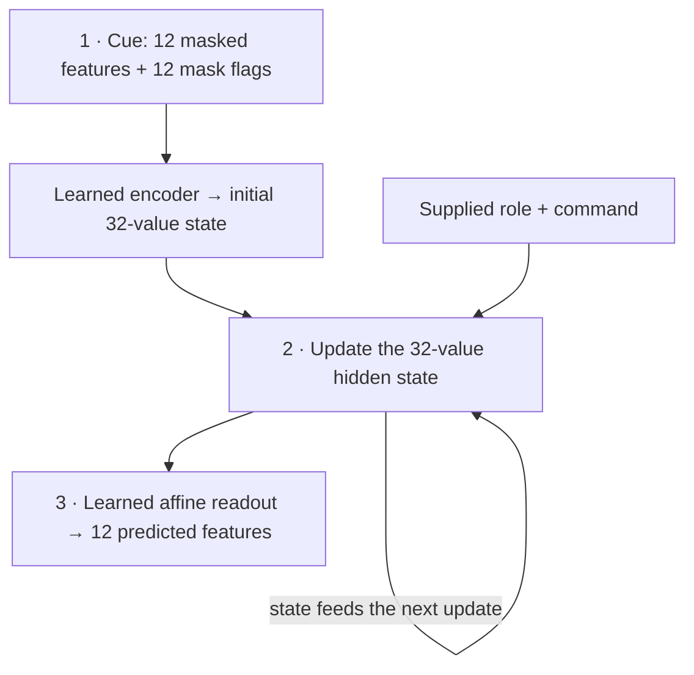

<link rel="stylesheet" href="{{ '/assets/soam-e1-results.css' | relative_url }}">

The first SOAM shared-population experiment is complete. The candidate, **S32**, is a recurrent neural network with 32 hidden activity values, reused for two jobs: reconstructing a partly observed input and predicting how it changes under commands. It combines symmetric recurrent connections with additional action-dependent asymmetric connections. These are software units, not measured biological neurons.

**S32 did not meet the requirements set before the test.** Understanding why requires separating three questions: can it produce an accurate answer, do the same state coordinates contribute to both jobs, and does recovery after a disturbance preserve the answer?

  
<strong>Accurate answers?</strong>Reconstruction error exceeded its preset limit.

  
<strong>The same units matter?</strong>Disabling units had large effects, but uncertainty intervals were too wide for the full claim.

  
<strong>Useful recovery?</strong>States moved closer together without meeting the accuracy and comparison requirements.

<nav class="e1-links" aria-label="Companion reading"><a href="{{ '/research/soam-e1-results/' | relative_url }}">Full report + data</a><a href="{{ '/research/soam-e1/' | relative_url }}">Original protocol</a></nav>

**Follow-up, November 11:** [Studies A and B]({{ '/blog/soam-studies-a-b-gates-and-correction/' | relative_url }}) now investigate recurrent gates and sensory correction in a separate [A–F series]({{ '/research/soam-studies/' | relative_url }}). The E1 results and historical next-step statements below retain their November 8 meaning; the negative E1 decision is unchanged.

## What the model sees and has to do

The learning environment is a small simulated world: a point in two dimensions. A **fixed sensor encoding** converts its position into 12 feature values. The network sees those features, not the point's coordinates or the simulator's equations. The 12 values come from two underlying coordinates; they are not 12 independent facts.

At the start of each episode, the model receives six randomly selected feature values with small added noise, a mask identifying the visible values, and a supplied role label. Missing values are zeroed, with the mask distinguishing them from observed zeros. Then it must do one of two jobs:

  
<strong>Recall: reconstruct and hold</strong>
One partial cue → ten zero-command updates → reconstruct all 12 original feature values.

The point stays still. No new observations arrive. The final reconstruction is scored.

  
<strong>Transition: predict movement</strong>
One partial cue + a sequence of commands → predict the next 12-feature vector after each command.

The point rotates, contracts slightly, and translates. Primary error averages the first eight predictions without new observations.

This is a description of the task, not an example of a trained trajectory. The model receives the command values, but must learn their consequences. In a separate **grounded** evaluation, a clean observation corrects the state *after* each prediction is scored. That helps distinguish one-step error from error accumulated during a free rollout. Evaluation also includes a longer, 32-step horizon.

Training supplies clean feature vectors as loss targets; they never enter a free evaluation rollout. Models are fitted offline, then their parameters are held fixed for testing. Training and confirmation use separate streams, with held-out initial-position sectors and action combinations. Roles are supplied, state resets between episodes, and the two jobs are never performed concurrently.

| Term used below | What it measures here |
| --- | --- |
| **Recall** | Reconstructing the clean 12-feature vector after ten updates. It is not the classification metric “recall,” and there are no positive/negative match labels. |
| **NMSE** | Mean squared error across **all 12 features**, divided by a fixed training-data variance. Zero is perfect; lower is better. It is not a percentage of incorrectly classified examples. |
| **Precision** | How narrow an uncertainty interval around an estimated effect is across independent fitted roots. It is not classification “precision.” A large average effect can still be too uncertain to meet the preset width limit. |

Error can arise when inferring missing/noisy features, evolving the hidden state, or decoding it back into features. Finite training and generalization to held-out inputs also matter; free prediction can accumulate mistakes. The final NMSE combines these sources, so it does not by itself identify which component failed. The [protocol]({{ '/research/soam-e1/' | relative_url }}) fixes the task and the [full report]({{ '/research/soam-e1-results/' | relative_url }}) records all controls.

## Retaining a memory does not make it accurate

### How hidden state becomes a reconstruction

S32 has three learned parts: a cue encoder, recurrent dynamics, and a readout. The fixed sensor encoding above belongs to the task; the cue encoder below is fitted with the network.

*Architecture diagram, not measured activations.* In step 1, the encoder mixes the cue and mask, adds a bias, and applies tanh. In step 2, recurrent connections mix the current activity with a proposed next activity. In step 3, each predicted feature is a weighted sum of hidden activities plus a bias:

$$
\hat z_t = D h_t + d.
$$

Here \\(h_t\\) is the 32-value hidden state at update \\(t\\), \\(D\\) is the learned 12-by-32 readout matrix, \\(d\\) is its 12-value bias, and \\(\hat z_t\\) is the predicted feature vector. The readout receives neither the correct answer nor a direct copy of the input. Learned parameters persist between episodes; the current episode's information must be carried in transient activity.

**Does producing a reconstruction establish memory?** It demonstrates an output, whose accuracy and dependence on the cue can be tested. It does not alone establish attraction to a useful stored state. E1 learns from continuously sampled positions; it has no explicit catalogue of pattern IDs, nearest-pattern lookup, or familiarity/rejection output. An output is a prediction, not a positive match decision. Zeroing the cue raises S32 recall error to about 1.0, so its output depends on input evidence—but dependence alone does not meet the accuracy requirement.

[Classical Hopfield memory](https://pmc.ncbi.nlm.nih.gov/articles/PMC346238/) motivates retrieving a complete pattern from a partial cue through settling dynamics. A basin is a set of starting states that reach the same attractor; it is not an automatic certificate that the retrieved answer is correct or that the input was familiar. “It settled somewhere” cannot substitute for comparison with the intended pattern. S32 is a trained continuous recurrent candidate, not a demonstrated classical pattern-memory system or a guaranteed nearest-pattern matcher.

### What the retention checks ask

**Retention** here means preserving the recall task while training the same network to perform transitions too. It is about keeping a learned ability, not retaining a file or testing storage hardware. The two guardrails ask whether final mean recall error is acceptably close to:

| Reference | Allowed worsening | Observed adjusted interval for S32 final minus reference |
| --- | --- | --- |
| S32's own recall-only checkpoint | At most 0.005 NMSE | [−0.05850, −0.00863] — passes |
| D25's final recall, using a separate recall population | At most 0.005 NMSE | [−0.01823, 0.00073] — passes |

Negative differences favor S32. Passing means each interval's upper end stays below 0.005. These are checks on **relative mean performance**; they do not guarantee good recall or improvement in every fitted root.

SOAM explores recurrent memory for embodied intelligence. Here, a 32-unit candidate, **S32**, used the same state coordinates to reconstruct a partly observed feature vector or predict its movement under commands. The task supplied the role; it did not ask the model to discover these jobs or perform them concurrently.

<figure class="e1-figure">
  
  <figcaption><strong>Better, but still outside the requirement.</strong> Faint dots are ten independent training-root means; thick marks show means and ordinary 95% root-bootstrap intervals. NMSE is squared prediction error normalized by a fixed training variance. Lower is better. <a href="{{ '/research/soam-e1-results/#root-level-primary-results-and-failures' | relative_url }}">Values and intervals</a>.</figcaption>
</figure>

The final mean error was **0.0777 against a required maximum of 0.02**. That maximum was a design requirement frozen before confirmation, not a natural constant or a cutoff discovered from these results. It requires mean squared reconstruction error no greater than 2% of the chosen training variance; it does not mean “98% of patterns correct.” All ten final root means exceeded it. The failure was therefore concrete: **S32 did not reconstruct the original feature vector accurately enough after ten updates**, even though it passed both relative checks.

### Why can recall improve when training adds another job?

  
<strong>Checkpoint at 100 updates</strong>
Recall training only.

Mean recall NMSE: <strong>0.1151</strong>.

  
<strong>Final checkpoint at 400 updates</strong>
300 more updates, each with a fresh recall batch <em>and</em> transition training.

Mean recall NMSE: <strong>0.0777</strong>.

Adding a task can introduce competing demands, but it does not require accuracy to worsen. Here, recall remains explicitly rewarded throughout joint training. The final network has also received more recall examples and optimization steps. Learning the transitions might additionally help it represent the underlying point, but **this experiment does not isolate that explanation**: it has no equally long, 400-update recall-only comparison. The defensible observation is improvement under this schedule, not proof that multitask learning caused it. Nor does an average improvement imply every root improved.

## The simpler comparisons matter

The controls ask different questions. D25 and G28 roughly match S32's parameter count; D16 and G32 match its total allocated neural-state width. These matches do not equalize active width, parameter count, and compute simultaneously.

| Control | What is shared between the two roles? | Purpose |
| --- | --- | --- |
| D25 / D16 | Separate activity banks **and separate fitted weights**, including encoders/readouts | Compare with independent populations |
| G28 / G32 | **One GRU state bank, one cue encoder, and one readout** serve both roles | Test competent ordinary shared recurrence |
| L12 | A 12-feature state with ridge-fitted cue reconstruction and transition maps | Test a simpler predictive approach |
| SYM32 | One state bank; asymmetric recurrent components omitted during fitting | Compare the recurrent mechanism |
| T32 | Two state banks with the **same S32 parameter objects** | Check what intact predictions can identify |

**Yes, the GRUs combine recall and transition in the same recurrent substrate.** They receive the supplied role and commands, follow the same recall-then-joint training schedule, and reset state between episodes. Their lower prediction errors are relevant to shared recurrence broadly. They challenge S32's particular symmetric-plus-asymmetric design, rather than showing that two functions must occupy separate populations. They do not independently prove that physical overlap causes the GRUs' advantage.

<figure class="e1-figure">
  
  <figcaption><strong>Ordinary recurrent controls were serious competitors.</strong> Free-8 means eight steps without fresh observations. Bars are ordinary 95% root intervals, not the adjusted paired benefit tests. D models split recall and transition populations; G models are gated recurrent units; L12 is linear; SYM32 omits the asymmetric component. T32 equals S32 exactly. <a href="{{ '/research/soam-e1-results/#model-errors-and-resource-differences' | relative_url }}">All endpoints and resource counts</a>.</figcaption>
</figure>

S32 passed the individual benefit test against D16. Its D25 estimate was positive but missed the precision requirement. Both GRUs had lower free-8 error on every root; L12 was inconclusive. The frozen rule required success against **all five** references. Different parameter counts and active widths also prevent treating every gap as an effect of sharing alone.

## A state can settle while losing the answer

In this probe, **useful information means enough information about the cued point to reconstruct its original 12 features accurately**. We make a small change to the initialized hidden state, then compare its ten-step recall trajectory with the unperturbed one. No new sensory information is supplied. This probe does not measure preservation of transition geometry; command-conditioned prediction is tested separately.

Two hidden states could converge to the same wrong answer—or to a constant independent of the cue. The diagnostic therefore checks decoded recall accuracy and output variation, as well as whether the perturbation gap shrinks and whether S32 improves on the zero-S control.

  <figure class="e1-figure">
    
    <figcaption><strong>Closer together…</strong> The ratio is distance now divided by distance immediately after perturbation. It is exactly 1 at step 0, now shown explicitly; the original figure began after the first update. Step 0 is a normalization identity, not an added measurement. Steps 1–10 and their ordinary 95% root intervals are unchanged.</figcaption>
  </figure>
  <figure class="e1-figure">
    
    <figcaption><strong>…does not mean closer to the answer.</strong> The faster-contracting control has far worse recall. Error bars: ordinary 95% root intervals. <a href="{{ '/research/soam-e1-results/#cue-dependence-and-finite-horizon-recovery' | relative_url }}">All recovery criteria</a>.</figcaption>
  </figure>

### Why removing S contracts faster

S32 has a symmetric matrix **S** plus asymmetric matrices **A**. The supplied role already switches **A off during recall**, and recall commands are zero. Setting S to zero in this probe therefore leaves **neither symmetric nor asymmetric recurrent matrix feedback**. It does not turn S32 into an asymmetric network. SYM32, the separately fitted symmetric-only control, is a different experiment condition.

With only the fixed leak and learned bias remaining, the recall update becomes:

$$
h_{t+1}=0.5h_t+0.5\tanh(b),\qquad
\Delta h_{t+1}=0.5\Delta h_t.
$$

The vector \\(b\\) is the same bias on both paths; \\(\Delta h_t\\) is their difference. Every step halves the difference, so the normalized gap is 1, 1/2, 1/4, and so on. But the control also washes out the cue-specific state, approaching the same bias-driven activity for every input. Fast contraction is unsurprising; accurate recall does not follow.

Symmetry can support energy-based stability under particular update rules and assumptions. It is not a general promise of faster settling or more accurate memory for this fitted, discrete system. S32 halved the gap in 97.5% of episodes; the zero-S control did so in 100%, leaving no required advantage. S32's perturbed mean recall error was 0.1086, above 0.02. A second accuracy check allowed at most 5% of episodes to exceed 0.05 recall error; 62% did. Those failures explain why the [full recovery diagnostic]({{ '/research/soam-e1-results/#cue-dependence-and-finite-horizon-recovery' | relative_url }}) did not pass.

## Identical predictions can hide different state organizations

Here, **weights** are learned coefficients; **state** is the current activity. Both organizations below use S32's same fitted coefficients for both roles. The difference is where activity lives:

- **S32:** one 32-value activity bank is reused for recall episodes and transition episodes. “Combined roles” means both abilities are trained into one network, not that two tasks run simultaneously.
- **T32:** recall has its own 32-value activity bank and transition has another, but both banks use the same tied S32 weights, including encoder and readout. T32 is not separately trained; each role activates only its bank.

With the same initial cue, role, commands, and reset, the active bank follows the same equation at every step. Its predictions must match. This compares **shared weights with shared activity coordinates** against **shared weights with separate activity coordinates**. D25/D16, with independently fitted weights, ask a different question.

<figure class="e1-figure">
  
  <figcaption><strong>The T32 identifiability limit.</strong> This is a design diagram, not neural anatomy. The intact predictions cannot identify physical sharing as their cause. Two allocated banks also do not establish an unavoidable memory cost: the inactive bank could be allocated lazily.</figcaption>
</figure>

The **full causal claim** required three things, with minimum effect sizes, positive adjusted lower bounds, and sufficiently narrow intervals: disabling the selected four S32 units must harm **both** roles; disabling their recurrent participation must add harm beyond hiding them from the readout alone; and both shifting the commands and removing the asymmetric component must harm transition prediction. The [six contrasts and thresholds]({{ '/research/soam-e1-results/#causal-overlap-and-direction' | relative_url }}) spell out those requirements.

The measured effects were large and all adjusted lower bounds were positive, including effects beyond readout masking. That supports sensitivity to these interventions. But **all six intervals exceeded their frozen width limits**, leaving the full claim unresolved. This is uncertainty about meeting the complete prespecified criteria, not evidence that the units do nothing. And even a precise pass would establish participation in this implementation's coordinates—not uniquely beneficial physical overlap, semantic neurons, or concurrent binding. T32's exact equality retains that limit.

For example, the targeted lesion's recall-error increase was 0.615, with adjusted interval [0.513, 0.738]. The effect is clearly positive, but its interval width of about 0.224 exceeds the required maximum of 0.02. That is the distinction between detecting an effect and estimating it to the precision this protocol demanded.

## What changes now

The decision is **stop promotion of this S32 candidate under E1 v1 + A1**. The evidence should change architectural expectations, with different confidence for observations and explanations.

| Status | Conclusion and its boundary |
| --- | --- |
| **Measured** | S32 recall was already poor at the early recall-only checkpoint and improved in mean during joint fitting. The final failure cannot simply be described as transition learning destroying an accurate memory. |
| **Measured** | G32 had the lowest mean primary free-8 error; G28 also beat S32 on every root with a near-matched parameter count. G32's larger parameter budget is not the only relevant comparison. “Best” is endpoint-specific: L12 had lower free-32 error than either GRU. G32's own recall mean, 0.02099, slightly exceeded 0.02; lower prediction error does not declare a passed SOAM gate. |
| **Supported interpretation** | For this task and finite training allocation, the special symmetric-plus-asymmetric construction did not earn preference over conventional shared recurrence. Useful input-dependent output and strong lesion effects are insufficient substitutes for accurate reconstruction and comparative prediction. |
| **Plausible explanation, untested** | A GRU's learned gates can vary how much each unit retains or updates according to its state, role, and command. S32 always blends old activity and its proposed update 50:50, relying on learned recurrence to preserve information. Flexible gating might make “hold this point” and “move this point” easier to learn in one network. The comparison does not isolate gating as the cause. |
| **Still unresolved** | Finite optimization, the cue encoder, readout, recurrent parameter constraints, and the task/objective combination could all contribute to S32's error. We have not isolated undertraining, a capacity limit, or an unavoidable trade-off. Two development configurations do not exhaust any family's possibilities. |

The gating explanation follows the [GRU update equations](https://docs.pytorch.org/docs/2.14/generated/torch.nn.GRUCell.html); its application to this performance gap is a hypothesis. No new diagnostic or fit has been run to establish it.

For recurrent sensorimotor research, the grounded lesson is to treat **holding an inferred state, updating it under commands, and recovering after disturbance as separately testable abilities**. Conventional gated recurrence belongs among serious candidate mechanisms for a shared substrate. A more speculative direction is that learned control over retention versus updating may matter more here than imposing symmetric structure; an identifiable follow-up would be needed to test that. This result neither selects that follow-up nor establishes that recurrence alone solves sensorimotor control.

The record contains 70 confirmation fits, seven exact reproduction fits, and 42 preserved development fits. No seeds were replaced or retuned. Reporting telemetry has disclosed gaps; the report explains why they qualify resource claims without overturning the measured negative gate.

The next eligible action is the separate SOAM-059 routing decision. No follow-up experiment has been launched. The three evidence requirements remain distinct:

| Question | Evidence it needs |
| --- | --- |
| **Accuracy: is the answer right?** | Compare decoded reconstructions and predictions with clean targets, including absolute limits and competent alternatives. |
| **Causal participation: do these state coordinates help produce it?** | Intervene on units and connections, compare with intact and readout-only controls, and quantify the resulting error changes and uncertainty. |
| **Recovery: does a disturbance lead back to a useful answer?** | Perturb state, track its distance from the unperturbed trajectory, and verify accurate, input-dependent output against a trivial contraction control. |

A network can be sensitive to its units yet inaccurate, or contract toward a trajectory that predicts the wrong thing. That is why each claim needs its own evidence.

[Read the companion report, all intervals, controls, and provenance →]({{ '/research/soam-e1-results/' | relative_url }})


