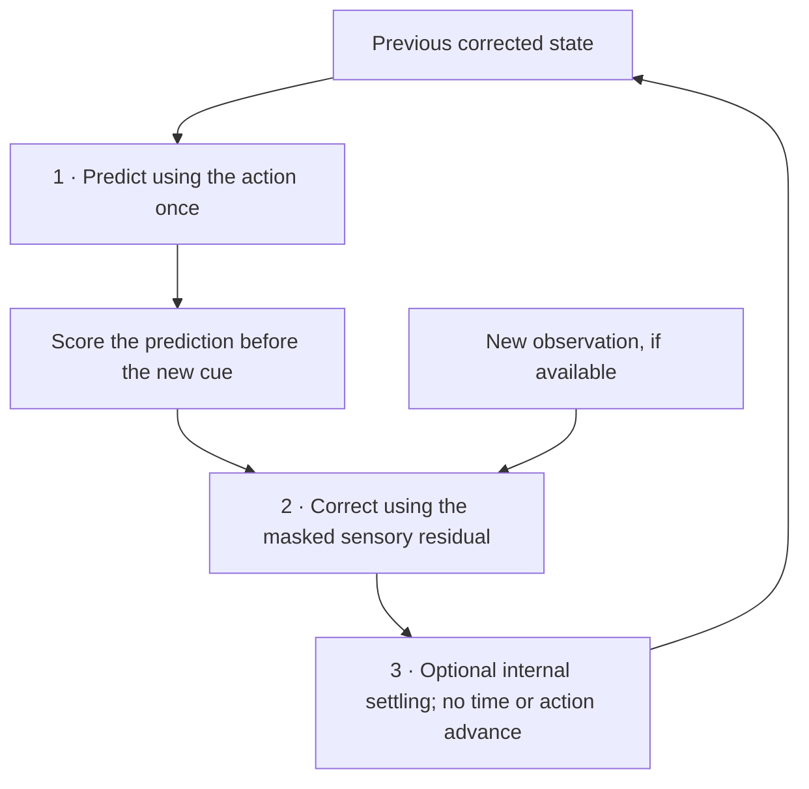

<link rel="stylesheet" href="{{ '/assets/soam-e1-results.css' | relative_url }}">


<strong>Follow-up, November 12:</strong> <a href="{{ '/blog/soam-study-b2-robust-correction/' | relative_url }}">Study B2 tests robust correction for the fitted filter</a>, with a new protocol and fresh confirmation. The A/B results and decisions below are preserved.

SOAM's first experiment left a useful problem: an ordinary gated recurrent network predicted more accurately than the proposed shared-memory candidate. **Studies A and B investigate what to retain from that result.** A asks what the gates contribute. B asks how a recurrent estimate should change when new sensory evidence arrives.

The outcome favors a simpler starting point than a mandatory gated-memory architecture. Adaptive gates improve some errors, but Study A does not establish its declared practical update-gate benefit. Study B supports separating prediction from sensory correction, while finding that learned sensory gain adds little practical advantage over a fixed correction in this task. A tiny fitted filter is more accurate and cheaper on the primary prediction measure, yet much more vulnerable to corrupted observations.

This begins **[Studies A–F]({{ '/research/soam-studies/' | relative_url }})**, a series of investigations I requested that branches from E1. A and B are complete; C–F remain proposed work on operating modes, persistent learning, navigable object memory, and population topology. E1's negative decision remains part of the record.

## The small world behind both studies

The environment contains a point moving in two dimensions. A fixed projection turns its position into twelve sensory features. Models receive features, visibility masks, commands, and supplied task roles. Training uses clean feature targets; true coordinate labels are confined to diagnostic probes and never enter inference. Neural weights are fitted offline and remain fixed during evaluation.

In Study A, a model sees one noisy partial cue. It must either reconstruct the original feature vector after ten stationary updates or predict a sequence of movements without further observations. Study B introduces observations arriving intermittently, along with missing features, noise, corrupt cues, genuine state changes, and sensing gaps.

Errors are reported as **normalized mean squared error**, or NMSE: squared feature error divided by a fixed training-data variance. Lower is better. An NMSE of 0.01 is not a 1% classification error. Each study averages related episodes within an independently fitted root before estimating uncertainty; hundreds of correlated timesteps are not hundreds of independent experiments.

These tasks isolate estimation and recurrent dynamics. Twelve projected features still describe a two-dimensional state, and six observed channels usually identify it. Success here would be a useful component result, not a demonstration of large associative-memory capacity or object discovery.

## Study A asks what the gates actually buy

A recurrent network carries a vector of temporary activity from one update to the next. A GRU learns two controls over that update. Its **update gate** controls how much old activity is retained versus replaced. Its **reset gate** controls how the old state contributes to the proposed replacement. Adaptive gates depend on the current inputs and state; a learned constant gate keeps one fitted setting per unit.

The main comparison is between **G32**, a full 32-unit GRU, and **FU38**, which retains adaptive reset but uses constant update gates. FU38's extra units bring its parameter count close to G32: 4,876 versus 4,940. Other controls hold width fixed, match ungated parameter or arithmetic budgets, remove reset adaptation, and test simple fitted linear dynamics.

An early development run exposed undertraining. Study A preserved that version, increased every neural candidate to 1,600 updates with a common learning-rate decay, and used fresh confirmation streams. This matters: a weakly trained baseline can make an architectural feature look essential.

### A positive effect that does not pass the practical rule

The primary score, J, equally averages reconstruction error and eight-step free prediction error. Across ten paired roots, G32 improves J over FU38 by **9.9172%**, with a family-adjusted interval of **0.6950% to 19.5834%**. The preset minimum was **10%**. Rounding the observed gain up would change the decision incorrectly.

There is a second problem. At 32 prediction steps, G32's error is higher by 0.006117 NMSE. The adjusted interval extends to 0.011991, beyond the allowed worsening of 0.01. Long-horizon protection is unresolved. Together, these checks make the registered outcome **inconclusive for practical adaptive-update benefit**. That preserves the positive measured effect without treating it as a completed practical success.

<figure class="e1-figure">
  
  <figcaption>Archived Study A primary estimate and adjusted interval. The threshold concerns the mean gain; other competence, precision, resource, and endpoint requirements also apply. <a href="{{ '/research/soam-studies-a-b/#study-a-design-and-results' | relative_url }}">Decision details and all models</a>.</figcaption>
</figure>

The full GRU does substantially outperform the tested ungated networks with similar parameter or inference-arithmetic budgets: roughly 49–51% lower paired J. Parameter count alone therefore does not explain its advantage. Training CPU remains unequal, however, and an equal-total-CPU ungated search was not run.

The ordinary **R32** network still meets the basic competence limits, using 32 units, a fixed 0.5 update rate, and 2,412 parameters. It sacrifices accuracy for simplicity. Selecting it for the next study was a post-study engineering judgment about the tested inventory, not proof of a minimum network size.

The longer rollouts also resist a single winner. FU38 has lower mean 32- and 128-step error than G32. Removing adaptive reset produces a different weakness at long horizons. A 110-parameter, two-state fitted model performs poorly on initial reconstruction but best on the 128-step diagnostic, where the contracting environment helps initial errors decay. Gates, initialization, training, and task structure each matter. [Study A report and evidence]({{ '/research/soam-studies-a-b/#study-a-design-and-results' | relative_url }})

## Study B separates movement from new evidence

A moving observer needs two distinct operations. First it predicts what movement should do to its internal estimate. Then, if an observation arrives, it corrects that estimate using the difference between expected and observed features. A third operation can refine the state internally without moving or receiving another observation.

*Inference sequence, not a plot of learned activity.* Persistent weights do not change in this loop. If no observation arrives, the prediction continues without correction.

Study B compares mixed-input recurrence with separate correction, adaptive sensory and motion gains, extra internal iterations, and simple fitted estimators. Its primary score measures the prediction **before** the next correction under intermittent partial, missing, and noisy sensing. Reconstructing the cue just received is a different measurement.

Separate correction helps in this finite comparison. **PC16**, a 16-unit ordinary recurrent model with fixed correction gain, has primary error 0.06242 versus 0.08899 for the same-width mixed-input control. The paired difference is −0.02656, with a descriptive 95% interval of −0.03180 to −0.02090. PC16 uses 1,340 fitted scalars and about 718 counted linear multiply-accumulate operations per physical step.

### Learned sensory gain exposes a robustness tradeoff

In the first version, learned sensory gain **GA32** improves the primary score over fixed-gain **PC32** by 3.44%, with an adjusted interval spanning −0.86% to 7.86%. Its corruption error is worse by 0.03435 NMSE, decisively beyond the allowed 0.01 margin. The formal result is a **tradeoff**.

The gate initially saw signed residual and action components. A simple affine gate cannot directly express every rule based on their magnitude, so a separately frozen supplement supplied residual RMS and action norm explicitly. It refitted the controls on fresh data rather than reusing the first confirmation set.

The augmented **GN32** gains **1.61%** over PC32, adjusted interval **0.52% to 2.68%**, and just **0.035%** over GA32, interval **−0.008% to 0.088%**. Both intervals exclude the declared 10% practical gain. All supplement guard margins pass. This is **negative evidence for that practical advantage in the tested setup**, with a small measured effect still visible.

### The best predictor is also easier to mislead

The strongest primary predictor is **FILTER2**, a fitted two-state filter. It learns an observation basis and dynamics from the same training feature targets, with a supplied two-dimensional model structure and nominal-noise assumption. It is not given the simulator equations or a projection inverse.

In Study B v1, FILTER2 reaches primary error **0.04180** with roughly **110 counted linear MACs per step**, compared with PC16's 0.06242 and 718. Under corruption, the ordering reverses: **0.37627 versus 0.11115**. Its mean corruption error is about 3.4 times PC16's. A strong response to useful evidence can also produce a strong response to false evidence.

<figure class="e1-figure">
  
  <figcaption>Measured v1 means and ordinary 95% root-bootstrap intervals for four reference models. Lower and farther left are better. The filter's arithmetic count excludes matrix solves; all counts exclude nonlinear arithmetic. The <a href="{{ '/research/soam-studies-a-b/#study-b-design-and-results' | relative_url }}">report retains every candidate and the fresh supplement separately</a>.</figcaption>
</figure>

Extra settling can help a model refine its state, but it also costs computation. Within the same SET32 weights, one and two extra iterations improve prediction before gains saturate. Against the cheaper independently trained PC16, its selected configuration has an uncertain primary improvement and worse corruption error. The evidence supports an optional, measured settling budget.

## What carries forward

The retained interface is straightforward: **predict, correct, optionally settle**. PC16 becomes the small robust neural reference, using its tested fixed gains. The fitted filter remains a strong comparison wherever its assumptions are appropriate. Sensory and motion gain channels stay separate, with learned controls available for future tests rather than required by the architecture.

This is a choice based on the observed accuracy, robustness, and cost tradeoffs. It does not establish useful attractors, online acquisition, concurrent object hypotheses, or biological validity. Those require different experiments. Study A completed 252 fitted executions; Study B completed 368 across its two versions. Both retained fixed seeds, separate confirmation data, numerical repeats, and negative results. Their scores use different tasks and must not be compared as one leaderboard.

The next questions in the A–F series concern operating modes, persistent changes to memory, object-relative navigation, and population organization. This publication records the first two studies; it selects no next experimental branch. The [full report and downloadable records]({{ '/research/soam-studies-a-b/' | relative_url }}) provide the evidence behind these choices.


