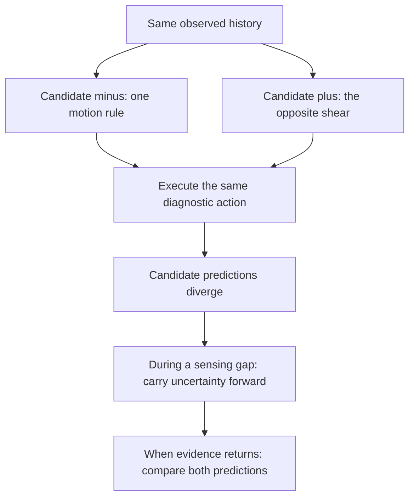
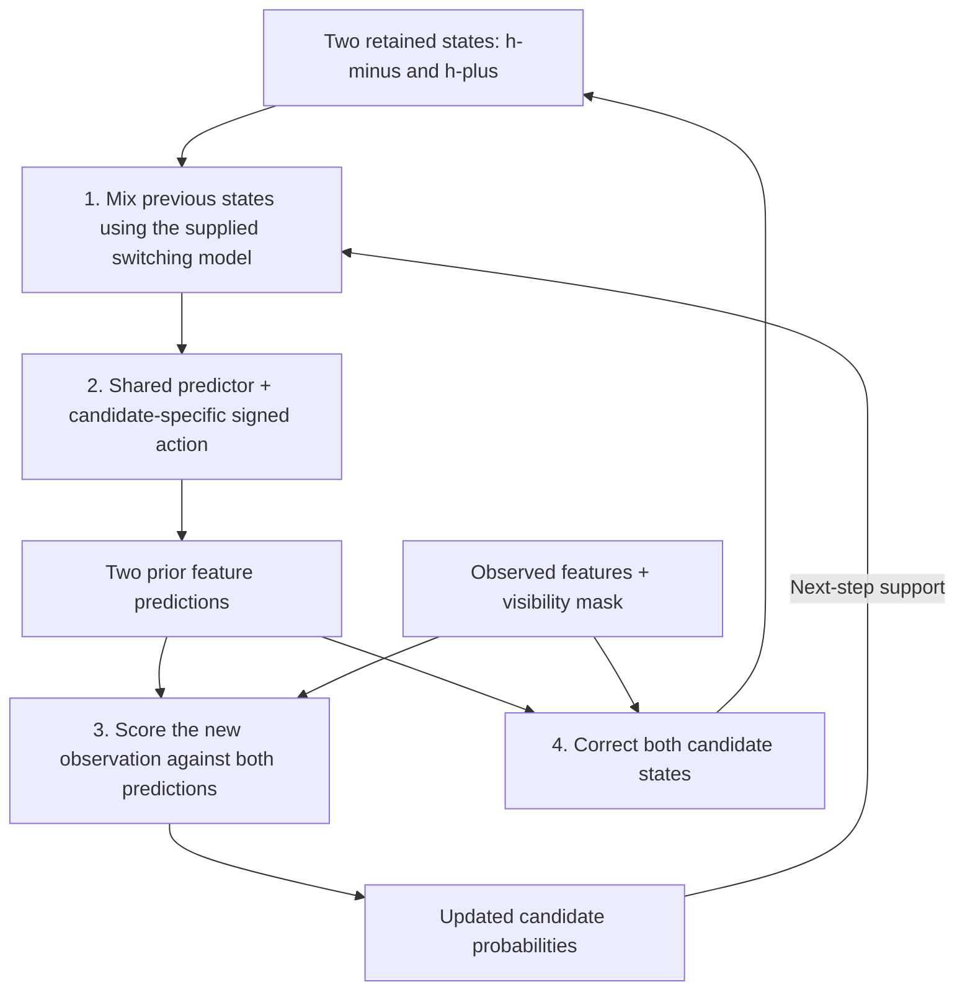
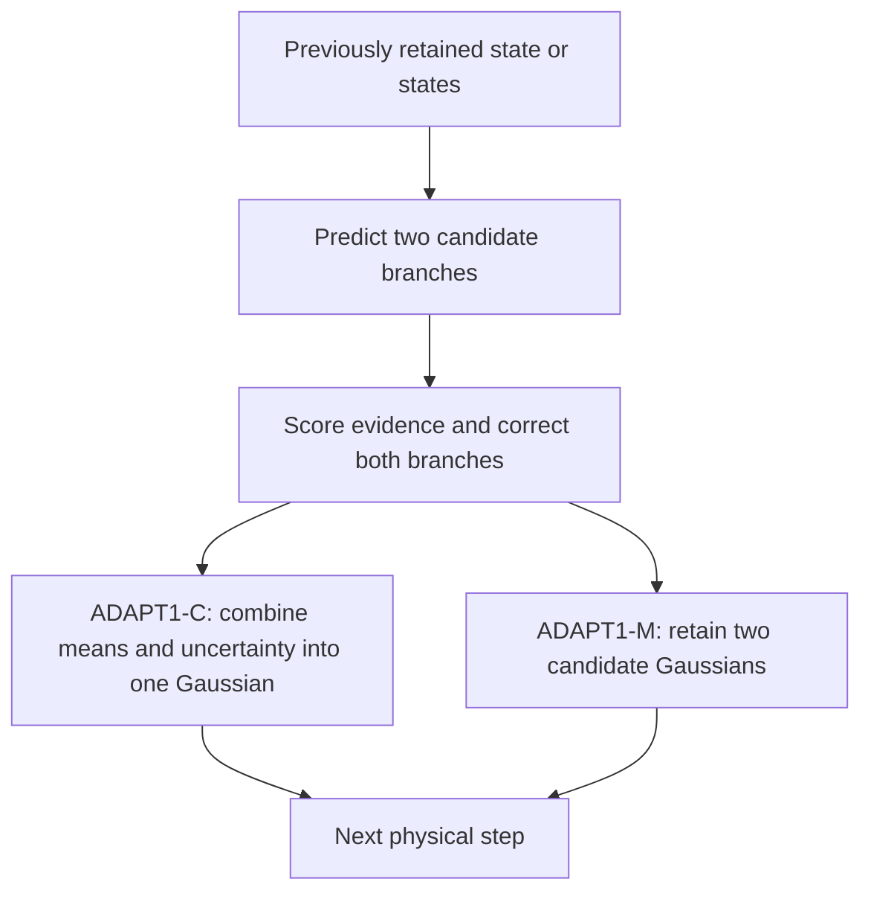

<link rel="stylesheet" href="{{ '/assets/soam-e1-results.css' | relative_url }}">
<link rel="stylesheet" href="{{ '/assets/soam-study-c.css' | relative_url }}">


## Introduction: uncertainty can require more than a confidence number

Imagine watching a system move when two different motion rules could explain everything seen so far. You can assign each rule a probability. But when observations disappear, do you also need to maintain a separate evolving state for each explanation? Or can one state, with enough uncertainty around it, preserve everything that matters?

**Study C tests that distinction.** Two recurrent states improve inference over both a small single-state neural model and a larger capacity control. Yet a compact conventional filter retaining one state remains competitive. And all the strongest models become overconfident when the observations could mean either a genuine change or coherent sensor corruption.

  
<strong>Supported neural benefit</strong>
Two recurrent states beat both single-state neural controls on the frozen probability score.

  
<strong>A simpler alternative survives</strong>
Keeping two conventional filter states adds less than the declared practical benefit.

  
<strong>An uncertainty limit remains</strong>
Representing two motion rules does not represent every possible cause of misleading evidence.

The [companion report]({{ '/research/soam-study-c/' | relative_url }}) contains the methods, all nine confirmed designs, uncertainty intervals, costs and downloadable evidence. This article builds the reasoning behind the result.

On smaller screens, scroll the block diagrams sideways to read them. Select a results figure to open it at full resolution.

## Background: what E1, A, B and B2 established

SOAM began as a proposal for recurrent memory in embodied intelligence: a system whose current activity can support prediction, interpretation and eventually action. These experiments test individual mechanisms before combining them into that broader architecture.

A **recurrent state** is a changing summary carried from one step to the next. **Parameters** are the fitted rules that update or decode that summary. Two states can share the same parameters while retaining different histories—just as two running calculations can use the same function with different inputs.

  
<strong>E1 · Is shared recurrence already useful?</strong>
The tested shared-population candidate failed its useful-sharing gate. Relative retention improved, but absolute reconstruction failed. Settling toward something did not ensure settling toward the right thing.

  
<strong>A · How elaborate must recurrence be?</strong>
Ordinary recurrence was competent. Gated models had accuracy advantages, but the declared practical adaptive-update benefit remained inconclusive. A simple recurrent core was retained as a reference.

  
<strong>B · How should new evidence enter?</strong>
Separate action prediction from sensory correction. A small fixed-gain recurrent model was useful; learned correction gain did not establish its declared practical advantage.

  
<strong>B2 · When should evidence be trusted?</strong>
Channel disagreement helped a small fitted filter resist inconsistent sensor errors while responding to real changes. Coherent false observations remained a problem.

[E1 results]({{ '/research/soam-e1-results/' | relative_url }}) · [A/B article and background]({{ '/blog/soam-studies-a-b-gates-and-correction/' | relative_url }}) · [B2 article]({{ '/blog/soam-study-b2-robust-correction/' | relative_url }})

Those results motivate C without deciding its answer. A probability attached to a single state may be enough. A conventional mixture may solve the problem without recurrence. Shared parameters are useful engineering, but they do not establish shared neurons, useful attractors or learned organization.

## Problem statement: make the ambiguity real

The benchmark is a two-dimensional system observed through twelve fixed projected features. Two supplied candidate motion rules differ in the sign of one action-dependent shear. Before a diagnostic action occurs, both rules generate exactly the same permitted history: observations, masks, actions and timing.

This is the task design, not a learned discovery of hypotheses. Candidate identities and their action semantics are supplied. Models receive neither the true identity nor simulator coordinates during inference. Paired worlds share their initial conditions and observation noise; the evaluator knows the answer, the estimator does not.

In a permanently uninformative condition, no amount of internal computation can distinguish the two worlds. An honest equal-prior answer is 50–50. The **binary Brier score** measures the squared error of the probability assigned to the positive candidate:

$$
B=(p-y)^2
$$

Here, *p* is the predicted probability and *y* is 1 when that candidate is true, otherwise 0. Lower is better. On a balanced pair of indistinguishable worlds, 50–50 gives 0.25; confident arbitrary commitment is worse on average. A useful estimator must preserve ambiguity when necessary and resolve it when new evidence actually distinguishes the candidates.

## Hypotheses: separate representation from scheduling

**C-H1 asks whether retaining distinct candidate states improves inference beyond competent single-state controls.** The comparison must survive a larger neural state and strong conventional alternatives. The frozen practical threshold is an absolute Brier improvement of **0.01**, with prediction, ambiguity and recovery guardrails.

Two further questions remain separate. **C-H2** asks whether selective updating saves computation without damaging unattended states. **C-H3** asks whether a learned scheduling policy is needed. This experiment fully updates every state: it supplies evidence for C-H1 only.

## Proposed design: two trajectories, one shared update rule

The neural comparison begins with **PC16**, a 16-value recurrent state derived from Study B's predict/correct design. It now has two candidate predictions and a confidence value. **PC32** increases the single state to 32 values. **TWO16** retains two 16-value states, sharing one fitted recurrent update and decoder.

This is a block diagram of the implemented TWO16 loop. Each candidate advances once for the same physical action; each observation produces one support update. Predictions are recorded before current evidence enters correction. A small, supplied switching hazard permits changes of regime. No fitted parameter changes during inference.

Both neural controls can express uncertainty; they are not forced to output a single label. TWO16 and PC32 retain the same total hidden width. However, TWO16 also has a more explicit conditional structure. The experiment tests that factorization, rather than proving that one unrestricted vector could never represent two possibilities.

The conventional comparison makes the distinction sharper. **ADAPT1-C** keeps one Gaussian state: a mean and a covariance describing uncertainty. **ADAPT1-M** keeps two. Both inherit B2's robust variance adaptation and use the same fitted observation and motion maps.

These are alternatives, not two outputs of one deployed model. Collapsing to one Gaussian preserves between-candidate uncertainty in its covariance and keeps the candidate probabilities. It saves retained state, while still computing two temporary branches. A single retained state therefore does not mean a single explanation or half the work.

## Experimental results: a neural benefit, with a strong conventional baseline

The study completed **67 fitted executions**, including development and repeat checks. Confirmation used **ten independently fitted roots**, each with 32 episodes per condition. The main score balances six ambiguity and reveal conditions. Intervals resample whole fitted roots; correlated timesteps are not treated as independent experiments.

<figure class="e1-figure">
  
  <figcaption>Measured confirmation effects; positive means the first design is better. Intervals adjust for the frozen family of sixteen primary and guard contrasts. The dashed line is the practical threshold, not a zero-effect test. All guardrails pass for the two supported neural comparisons.</figcaption>
</figure>

The improvement survives the neural capacity control: TWO16 gains **0.01819 Brier [0.01505, 0.02204]** over PC32. The conventional mixture gains only **0.00157 [0.00136, 0.00183]** over its collapsed counterpart, precisely smaller than the practical target. TWO16 also has no declared practical probability-score advantage over the conventional mixture. These are informative negative practical results, not claims of exact equality.

When a delayed observation first returns, retaining candidate trajectories helps most visibly:

<figure class="e1-figure">
  
  <figcaption>Descriptive delayed-cue results with ordinary 95% root intervals. First evidence arrives at step 28; the next cue is at step 32. TWO16's tiny first-cue score reflects a fixed log-odds cap, not exact Bayesian certainty. This secondary view explains behavior; it does not replace the frozen primary endpoint.</figcaption>
</figure>

## The hardest failure: a coherent lie can look like a real change

B2's information limit returns in a more explicit form. One world really changes motion regime. In a second, the regime stays the same but corrupted sensing presents exactly the first world's observations. Actions and the full evidence history are identical. Correct causal implementations must produce identical outputs in both worlds—and all nine models do.

That invariance does not make their confidence appropriate. Across this constructed equal-prior cause pair, TWO16 and the robust filters strongly favor one answer. Their paired Brier scores are about **0.445–0.450**, well above the **0.25** information-limit optimum.

<figure class="e1-figure">
  
  <figcaption>Descriptive post-event stress analysis, with ordinary 95% root intervals. The two represented motion regimes do not include a separate coherent-sensor-fault cause. This is an uncertainty failure outside the nominal model assumptions, not a replacement primary gate.</figcaption>
</figure>

The model's hypothesis set is part of its answer. Keeping two motion trajectories cannot create an omitted explanation, and copying more states cannot create distinguishing evidence. Study C supports a bounded nominal-task benefit, not general ambiguity handling.

## Cost and conclusion: the best choice depends on what is scarce

**ADAPT1-C is the compact conventional reference.** It retains eight numerical scalars, fits cheaply, and has lower feature-prediction error than TWO16. **TWO16 is the faster recurrent alternative in this implementation.** Its serial p95 is about 116 microseconds per step versus about 410 for ADAPT1-C and 408 for ADAPT1-M. The recurrent model retains 33 scalars and requires many more fitted coefficients.

Those timings include the actual small solves, mixing and software overhead on an Apple M3 Max with one Torch thread. The robust filters use float64 and the neural models float32, so this is a measured implementation tradeoff rather than a precision-matched algorithmic speed theorem.

The result favors explicit conditional structure within the tested neural family. It also preserves a simpler conventional answer. Neither result changes E1's failed sharing gate or establishes attractors, learned organization, object memory or operating modes.

## Future study: earn selective computation separately

Selective updating remains a reasonable question, but C-H1 does not make it the automatic next experiment. TWO16's p95 overhead over the equally wide PC32 is only about 12% here; every state was fully updated. The coherent-cause failure concerns missing assumptions or information, not demonstrated wasted computation.

A future scheduling study would need complementary components that can coexist and move independently. It should compare full updating, freezing, motion-only tracking, round-robin updates and a simple uncertainty rule at a fixed budget, counting catch-up work and stale-state error. A learned controller would need to beat those simpler policies.

A different future question is whether an explicit fault-cause model or an independent observation can improve uncertainty when evidence has multiple explanations. Neither follow-up has been selected or run. The next decision should follow the smallest experiment that can distinguish the competing explanations, rather than treating the entire roadmap as a queue.

[Full report, results and evidence downloads]({{ '/research/soam-study-c/' | relative_url }}) · [Study C decision record]({{ '/assets/research/soam-study-c/STUDY_C_DECISION.txt' | relative_url }}) · [Studies A–F]({{ '/research/soam-studies/' | relative_url }})


