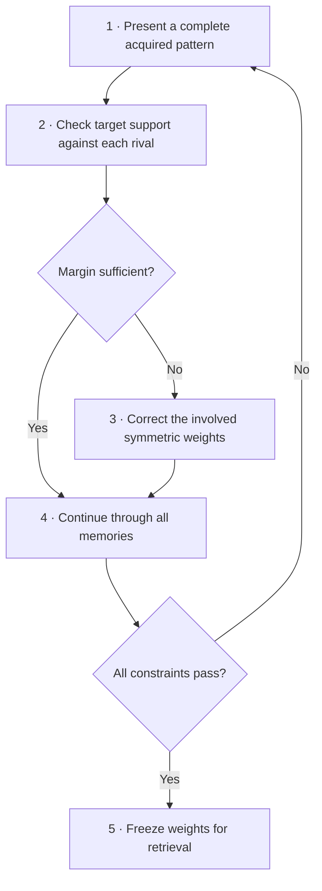
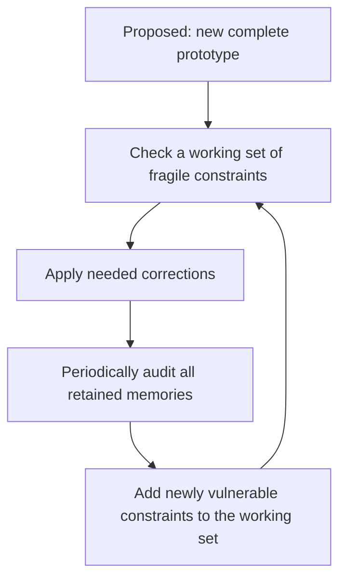

<link rel="stylesheet" href="{{ '/assets/soam-writer.css' | relative_url }}">

Two memories can be easy to tell apart on paper and still interfere inside a shared network. Our latest experiment repaired that interference by changing how the memories were written. The representation and retrieval dynamics stayed the same.

Ordinary retrieval on resolving observations rose from **578 to 1,018 correct responses out of 1,024**. The result also made a different failure harder to ignore: when observations genuinely could not distinguish the memories, the repaired system confidently chose an answer anyway.

  
<strong>32 / 32</strong>similar pairs passed the local storage test, up from 4

  
<strong>99.4%</strong>exact ordinary recall on resolving observations, up from 56.4%

  
<strong>50%</strong>wrong answers on ambiguous observations, all accepted

These are development results on four previously exposed banks of sixteen memories each. They establish a useful mechanism correction, with a [companion evidence report]({{ '/research/soam-corrective-memory-writing/' | relative_url }}) for the counts, controls and limits.

## A complete pattern still has to survive a shared write

Each memory is a row of sixteen categorical groups. Every group contains one of four symbols. Two similar memories—the “twins”—share twelve groups and differ in four. A bank contains eight such pairs. Each complete key also has two associated sixteen-bit feature patterns, selected by an observed context.

The patterns supplied for writing were already complete. We were not joining fragments into prototypes. The question was how to embed those individual patterns in **one shared matrix of recurrent connections**.

The original writer accumulated centered co-occurrences. For each clean pattern, it added contributions linking its active symbols. In compact form, its starting point was a sum of outer products:

$$
W = \frac{1}{M}\sum_{\mu=1}^{M}
(x^{\mu}-\bar{x})(x^{\mu}-\bar{x})^{\mathsf T}.
$$

Here \\(M=16\\) is the number of complete keys in one bank; \\(x^{\mu}\\) is a 64-component one-hot key; and \\(\bar{x}\\) has value one quarter in every component. Connections within each four-symbol group are then set to zero. The matrix is symmetric.

Every pattern contributes to the same connections. Shared structure reinforces itself; distinctions can compete. The writer can accumulate the requested correlations while leaving one particular symbol supported less strongly than a rival. Adding complete patterns individually does not prevent that interference.

This matters for interpreting the [earlier retrieval failures]({{ '/blog/soam-cue-completion-and-retained-guesses/' | relative_url }}). Before blaming cue geometry or changing the representation, we needed to check whether the stored weights supported the memories at all.

## Staying still is weaker than restoring a missing symbol

During retrieval, a group changes only when a unique winning symbol has positive support and strictly beats its current support. Otherwise it keeps its current state. This means a clean memory can stay put on a tie while a blank coordinate cannot reconstruct the intended symbol.

The cue-basin diagnostic tested both behaviors. Twenty-eight of the thirty-two pairs contained a failure to restore a distinguishing symbol even when the other fifteen groups were correct. Only four pairs passed the full local test for both members.

One recorded defect was especially direct. In bank 1, memory 7, group 6, the target was symbol 3. The old writer gave it support **.140625**, just below symbol 4 at **.156250**. Erase that group and the network chooses the rival.

<figure class="writer-figure">
  <a href="{{ '/assets/research/soam-writer/local-support.svg' | relative_url }}"><picture><source media="(max-width: 600px)" srcset="{{ '/assets/research/soam-writer/local-support-mobile.svg' | relative_url }}"></picture></a>
  <figcaption>The same complete memory, erased group and update rule. Only W changes. The corrected target exceeds every rival, including the inactive state with support zero. Values are archived measurements, not an illustrative landscape.</figcaption>
</figure>

The repaired trajectory is **missing → 3 → 3**, where the original was **missing → 4 → 4**. That is the behavior the new writer was designed to make possible for every supplied memory.

## Write a reconstructability constraint, then correct violations

The corrective writer asks a concrete question for each pattern and group: with the other fifteen groups correct, does the target symbol beat every alternative by a positive margin?

There are four alternatives: the three other active symbols and the inactive state. The latter matters because a positive advantage over other symbols is insufficient if all fields are negative.

This is an iterative write. A correction for one pattern can disturb another, so the writer revisits the set. It does not merely append an independent memory record.

The mathematical step is small. Collect the 1,920 independent symmetric cross-group weights into a vector \\(w\\). For one target-versus-rival comparison, construct a vector \\(a\\) so that \\(a^{\mathsf T}w\\) is the target's support advantage. The training constraint is \\(a^{\mathsf T}w\geq1\\). If it fails, update:

$$
w_{\mathrm{new}}
=w+\frac{\max(0,\,1-a^{\mathsf T}w)}{\lVert a\rVert^2}\,a.
$$

The step moves just far enough to satisfy **that one** inequality with the smallest Euclidean change to the current weights. It does not guarantee that all earlier inequalities remain satisfied. Repeated checks are essential. The full bank supplies 1,024 inequalities: sixteen memories, sixteen groups and four alternatives.

WR1 starts from zero and visits these constraints in a fixed order. The four bank fits reached their criterion in **78, 70, 66 and 90 passes**. The resulting matrix is scaled to the old matrix's norm and rounded to a fixed numerical grid; the final weights are then evaluated. The runtime matrix remains 64×64. The price is more acquisition work and explicit replay, not a larger inference representation.

## Better local storage translated into ordinary recall

With the new writer, both members of all **32/32 pairs** passed the clean-stability and strict single-group restoration checks. When every group was allowed to move after one erasure, **2,048/2,048** tested trajectories recovered exactly, up from 542. Those cases are correlated tests within four banks, not thousands of independent experiments.

The next study, WR2, reused the repaired weights without fitting anything. Ordinary retrieval first receives ten observed groups and then two more. The resolving condition reveals enough to distinguish the twins. The same cue seeding, two sweeps, lane scoring, feature projection and four feature updates remain in place.

<figure class="writer-figure">
  <a href="{{ '/assets/research/soam-writer/ordinary-recall.svg' | relative_url }}"><picture><source media="(max-width: 600px)" srcset="{{ '/assets/research/soam-writer/ordinary-recall-mobile.svg' | relative_url }}"></picture></a>
  <figcaption>Ordinary restart retrieval, before and after changing only the cue writer. The dotted line is 256/256, achieved by the unchanged exact-compatible lookup reference in every bank. Four exposed development banks; no population confidence interval. <a href="{{ '/assets/research/soam-writer/recall-counts.csv' | relative_url }}">Download counts</a>.</figcaption>
</figure>

The gains passed the frozen improvement criterion and the safeguards against increased bit errors or concentrated member losses. Thirty pairs recovered every resolving response. Errors remained in two pairs. Carrying earlier inferred candidates forward still lost to restarting from the accumulated observations: **970 versus 1,018** correct responses with the repaired weights.

The significance is specific and useful. This representation could support far better memory than the old writing rule delivered. A fundamental representation redesign was unnecessary to obtain this improvement. We have not measured a capacity ceiling or shown superiority over other optimized associative-memory writers.

## Explore the failure that remains

A local guarantee assumes the other fifteen groups are correct. Ordinary cues leave several groups unknown. Their fields can therefore favor a different completion.

The recorded example below is bank 1, row 96, memory 6, context 1. Its twin is memory 15. The second glimpse resolves their identity, but four groups remain missing. **This widget plays archived arrays; it does not run a model.** Target labels and error marks are explanations added by the evaluator.

  
Recorded trace · resolving observation

  
Target memory 6

  
Similar memory 15

  

    <label>Writer<select id="writer-rule"><option value="corrective">Corrective</option><option value="cooccurrence">Co-occurrence</option></select></label>
    <label>Retrieval<select id="writer-policy"><option value="restart">Restart</option><option value="retain">Retain</option></select></label>
    <label>Recorded stage<select id="writer-step"><option value="-1">Before reseeding</option><option value="0">Seeded</option><option value="1">Sweep 1</option><option value="2" selected>Sweep 2</option></select></label>
  

  
Each cell shows its group index above its symbol. A dot is missing; a solid bottom border marks observed evidence; a dashed border marks a nonmissing symbol that differs from the target.

  
Lane 0 · ascending visits

  
Lane 1 · descending visits

  
Loading the archived trace. The explanation below also describes the result without JavaScript.

  
<label>Inspect local fields<select id="writer-group"><option value="12">Group 12</option><option value="3">Group 3</option><option value="5">Group 5</option><option value="15">Group 15</option></select></label>

  
<table id="writer-fields"></table>

  <output class="writer-outcome" id="writer-outcome" aria-live="polite"></output>

Try **Corrective / Restart / Seeded**. Lane 1 starts group 12 with the correct symbol 3. Now choose **Sweep 1**. When that group is visited, groups 3 and 5 are still blank; rival symbol 4 has support **.562760**, just above the current symbol's **.540008**. The correct seed is replaced. Both lanes end with three wrong groups.

The feature output has five wrong bits and a minimum absolute value of **.594966**, above the acceptance threshold .5. This is a confident error. Switch to **Retain / Sweep 2**: the previously recovered correct lane survives and receives the higher support score. Retention helps this example while remaining worse overall. A good story about one trajectory cannot replace the aggregate comparison.

## Stronger completion can produce stronger unjustified confidence

In the ambiguous condition, the complete observation history is identical for the two twins, but their target features differ. No deterministic trajectory can identify which twin generated that history. More settling does not add the missing evidence.

<figure class="writer-figure">
  <a href="{{ '/assets/research/soam-writer/confidence.svg' | relative_url }}"><picture><source media="(max-width: 600px)" srcset="{{ '/assets/research/soam-writer/confidence-mobile.svg' | relative_url }}"></picture></a>
  <figcaption>Acceptance uses the unchanged magnitude threshold. “Accepted correct” on ambiguous rows means a match to the evaluator's hidden label, not identified recall: twins receive identical outputs. Corrective restart has one accepted error on resolving inputs, but 512 on ambiguous inputs. Small segments and all exact counts are in the <a href="{{ '/assets/research/soam-writer/confidence-counts.csv' | relative_url }}">CSV</a>.</figcaption>
</figure>

All four writer/policy combinations fail the joint reliability criterion. Exact-compatible lookup reconstructs every resolving target and abstains on every ambiguous case under this task's favorable noiseless, aligned conditions. It remains the practical reference. Better writing repairs support for memories; it does not automatically teach the system when it lacks evidence to choose one.

## The idea has substantial precedents

This is a familiar learning principle applied to a newly isolated failure in SOAM. [Hopfield's 1982 model](https://authors.library.caltech.edu/records/w41x7-8bn13) established the classic recurrent content-addressable-memory setting. [Diederich and Opper (1987)](https://journals.aps.org/prl/abstract/10.1103/PhysRevLett.58.949) developed local corrective prescriptions for storing correlated patterns. Their models and assumptions differ from our symmetric grouped-symbol implementation, but the relevance is direct: correlated memories need not be limited to simple correlation accumulation.

The one-constraint projection also has a close mathematical counterpart in [passive-aggressive learning](https://jmlr.org/papers/v7/crammer06a.html), which changes weights minimally to satisfy a current margin constraint. Here the constraints encode recurrent reconstructability and share a symmetry-constrained weight vector. That connection identifies the update family; it does not transfer a classification theorem into a basin-recovery guarantee.

Our contribution here is the controlled comparison: hold the codes and retrieval dynamics fixed, show the local defect is avoidable, then test whether the repaired writing helps ordinary retrieval. We did not compare against every competent writer, and we are not claiming a new state-of-the-art memory algorithm.

## Biological analogies: useful directions, different levels of evidence

The attractive biological idea is that learning can revisit fragile memories and correct insufficient support. Several research strands make that a reasonable inspiration. They do not establish that the brain implements this solver.

  <article>Human evidence<strong>Replay can favor weak memories</strong>
<a href="https://www.nature.com/articles/s41467-018-06213-1">Schapiro and colleagues (2018)</a> used fMRI pattern analysis to study hippocampal replay. Less well-remembered items were replayed more during subsequent rest; replay also predicted later memory. This motivates prioritizing vulnerable distinctions. It does not measure our field inequalities or prove the same correction mechanism.
</article>
  <article>Computational model<strong>Fast and slow synaptic processes can cooperate</strong>
<a href="https://www.nature.com/articles/nn.4401">Benna and Fusi (2016)</a> modeled interacting synaptic variables on multiple timescales, with bidirectional exchange protecting memories against overwriting. That suggests a consolidation analogy for fast acquisition plus slower repair. It does not provide a compressed certificate of all our reconstruction constraints.
</article>
  <article>Computational models<strong>Useful errors can be available locally</strong>
<a href="https://journals.plos.org/ploscompbiol/article?id=10.1371/journal.pcbi.1004439">Alemi and colleagues (2015)</a> studied a three-threshold recurrent learning rule using local fields. <a href="https://pmc.ncbi.nlm.nih.gov/articles/PMC8685685/">Mikulasch and colleagues (2021)</a> modeled local dendritic excitation–inhibition mismatch as a learning signal. These are specific alternatives to demanding an explicit global error signal, under their own circuit assumptions.
</article>

WR1 still replays every complete key, coordinates symmetric weights, evaluates all declared constraints and uses global normalization. It has not been implemented as a local spiking circuit, tested against synaptic sign constraints, or validated biologically. The analogy is a research direction, not a neuroscientific result.

## Could cumulative constraints make writing cheaper?

The current writer is intentionally straightforward: revisit every prototype until the local requirements pass. A possible optimization is to keep a compact working set of the constraints most at risk, or compress constraints that are redundant, while periodically checking the full set.

This diagram is a **future proposal**, not the measured writer. A moving average can preserve average behavior while losing the one distinction that identifies a twin. A useful summary must protect the weakest relevant reconstruction requirements, or disclose the approximation it makes.

We have no logarithmic-memory or constant-time guarantee. Each sparse correction touches only a subset of weights, but finding violated constraints, replaying patterns, maintaining the summary and auditing old memories all cost work. Fixed representation size also does not imply unlimited exact capacity. Any future comparison should include those costs and measure the worst-memory regressions against full replay.

## What comes next scientifically

The immediate open issue is separating strong internal completion from evidence sufficient to commit. Candidate diversity, compatibility with observations and abstention deserve a controlled comparison before treating high output magnitude as certainty. The residual multi-group failures also show that single-erasure support leaves part of ordinary access unresolved.

Beyond that, an embodied learner must decide which observations belong to the same item, construct prototypes under noise and viewpoint change, and update old memories while acquiring new ones. Our complete supplied keys and aligned glimpses bypass those acquisition problems. Selective replay, compact constraints, local learning and trajectory-sensitive readouts remain possibilities to test, not completed capabilities or an activated experiment plan.

The practical lesson is to check the learning objective before redesigning the representational space. Here, making the writer answer for each memory repaired most ordinary retrieval failures. The next challenge is making a successful completion carry the right amount of uncertainty.

