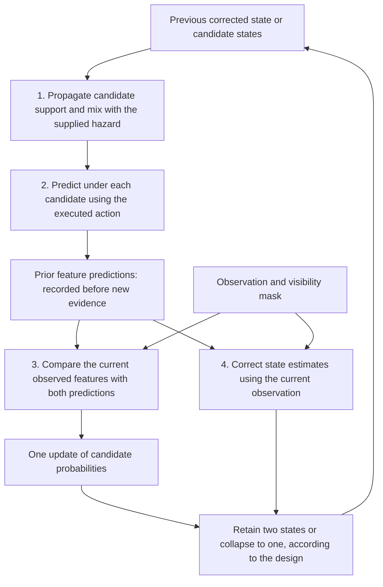

<link rel="stylesheet" href="{{ '/assets/soam-e1-results.css' | relative_url }}">
<link rel="stylesheet" href="{{ '/assets/soam-study-c.css' | relative_url }}">


## Introduction and conclusion at a glance

**Completed November 14, 2026.** Two shared-parameter recurrent states improve the frozen probability score over both single-state neural controls. The benefit survives the larger capacity control. A conventional estimator retaining one Gaussian state remains sufficient within the declared 0.01 Brier practical margin, while TWO16 offers lower measured inference latency. Coherent corruption versus genuine change remains an unresolved uncertainty failure.

This report records **C-H1**, the first bounded Study C experiment. It does not report selective scheduling, complementary objects or learned operating modes. The [visual article]({{ '/blog/soam-study-c-hypothesis-preservation/' | relative_url }}) introduces the concepts; this page supplies the full comparison and evidence links.

On smaller screens, scroll wide tables and the block diagram sideways. Select a results figure to open it at full resolution.

**In this report:** [Background](#background-and-problem-statement) · [Hypotheses](#hypotheses-and-frozen-decision-rule) · [Task](#task-and-observability) · [Designs](#proposed-designs-and-information-parity) · [Methods](#development-confirmation-and-uncertainty) · [Results](#experimental-results) · [Failure analysis](#calibration-and-the-coherent-cause-failure) · [Resources](#resources-and-exposure) · [Future study](#conclusion-and-future-study) · [Evidence](#evidence-downloads-and-reproducibility)

## Background and problem statement

SOAM's broad motivation is recurrent memory for embodied intelligence. A recurrent model carries a changing **state** between observations; fitted **parameters** specify how that state evolves. E1 tested a particular shared-population architecture and failed its useful-sharing gate. Study A established competent ordinary recurrent references while leaving the declared practical adaptive-update benefit inconclusive. Study B retained separate action prediction and sensory correction; learned gain fell short of its practical target in the fresh magnitude comparison. B2 improved a tiny conventional filter's robustness using channel disagreement, while preserving a coherent-corruption failure and a measured latency disadvantage.

Those findings are preserved: [E1]({{ '/research/soam-e1-results/' | relative_url }}), [A/B]({{ '/research/soam-studies-a-b/' | relative_url }}), [B2]({{ '/research/soam-study-b2/' | relative_url }}). Better results on C's changed task do not retroactively pass an earlier gate.

C asks whether uncertainty needs **separate retained trajectories**, rather than just a larger single state and candidate probabilities. A Gaussian conventional estimator is a particularly important control: its mean summarizes location and its covariance carries uncertainty, including uncertainty caused by competing explanations. Keeping one Gaussian still permits two temporary predictions and a probability for each candidate.

## Hypotheses and frozen decision rule

| Question | Operational test | Status |
| --- | --- | --- |
| **C-H1: hypothesis preservation** | Do two candidate states improve a proper probability score over competent single-state controls, including a larger neural state and conventional estimators? | Tested here; neural-family benefit supported, conventional practical multiplicity benefit precisely excluded. |
| **C-H2: selective computation** | Can a supplied allocation rule save updates while preserving unattended states and recovery? | Deferred; every candidate is fully updated here. |
| **C-H3: learned allocation** | Does a learned scheduler overcome a measured limitation of simpler policies? | Deferred; no learned scheduler was fitted. |

The primary score is binary Brier, the mean squared difference between the probability of the positive candidate and its binary truth label. It uses the one-probability definition, not the sum over two class probabilities. Brier scores candidate support after any evidence update; prior feature-prediction error is scored separately before current evidence. Pre/post-reveal phases and the six primary conditions are equally weighted within each root. The minimum meaningful improvement is **0.01 absolute Brier**. It is neither a 1% relative gain nor a classification-error threshold.

Four comparisons form the frozen family: TWO16 versus PC16; TWO16 versus the development-selected larger single-state reference; ADAPT1-M versus ADAPT1-C; and TWO16 versus ADAPT1-M. Their four benefit contrasts plus twelve prediction/ambiguity/recovery contrasts receive Bonferroni adjustment. Passing also requires competence, precision, optimization, capacity and resource checks.

| Criterion | Frozen requirement |
| --- | --- |
| Primary benefit | At least 0.01 improvement; positive adjusted lower bound; interval width at most 0.04 |
| Prediction worsening | Adjusted upper difference in prior feature NMSE at most 0.02 |
| Ambiguity worsening | Adjusted upper difference in ambiguous Brier at most 0.01 |
| Recovery worsening | Adjusted upper delay difference at most four steps |
| Absolute competence | Ambiguous Brier at most 0.26; late Brier at most 0.15; prior NMSE at most 0.25 |
| False confidence | Ordinary 95% upper bound on the >0.95-confidence ambiguity rate at most 0.05 |
| Single-state reference competence | Late Brier at most 0.18 and prior NMSE at most 0.30 |

The [protocol]({{ '/assets/research/soam-study-c/STUDY_C_PROTOCOL.txt' | relative_url }}) owns all definitions, conjunctions and resource/capacity rules. [Machine-readable checks]({{ '/assets/research/soam-study-c/statistics.json' | relative_url }}) retain both passes and failures. Criteria were fixed before confirmation; a precise exclusion of practical benefit is not a claim of zero effect.

## Task and observability

The hidden simulator position has two coordinates. Candidate regime *k* is either −1 or +1. The executed action has three components. Its first component causes a shear whose sign depends on the candidate:

$$
\begin{aligned}
x_{1,t+1}&=0.98x_{1,t}+0.08k\,a_{0,t}x_{2,t}+0.03a_{1,t},\\
x_{2,t+1}&=0.98x_{2,t}+0.03a_{2,t}.
\end{aligned}
$$

These are the **task/evaluator equations**, not privileged equations supplied to the fitted filters. A fixed seed-1729 projection maps position to twelve features. Initial first coordinates lie in [−0.5, 0.5]; the absolute second coordinate lies in [0.4, 0.8], with a random sign. Gaussian observation noise has standard deviation 0.01. Initialization exposes twelve channels; later sensed observations expose six, with gaps determined by condition.

When the shear action is zero, both regimes have identical dynamics. Paired worlds also share initial state, observation noise, masks, actions and timestamps; batch order is permuted. Thus their **complete permitted histories** coincide before identifying evidence. Translation alone cannot reveal the regime. A nonzero shear action separates predictions when the relevant second coordinate is nonzero. Analytical equivalence and numerical visible-rank checks appear in the [observability record]({{ '/assets/research/soam-study-c/observability.json' | relative_url }}).

  
<b>Before step 12</b>Same history under both candidates; no diagnostic action.

  
<b>Steps 12–27</b>Diagnostic movement, with sensing absent. Candidate states must evolve through the gap.

  
<b>Step 28 onward</b>Evidence returns. Score it against prior predictions, then correct.

| Condition | What it distinguishes |
| --- | --- |
| Later reveal | Shared initial history, then identifying action and evidence |
| Persistent ambiguity | No identifying evidence arrives |
| Uninformative actions | Actions occur, but do not distinguish the two rules |
| Diagnostic actions | Informative action-dependent differences can be observed |
| Misleading cues | Steps 12–19 favor the other candidate; true cues resume at step 20 |
| Delayed reveal | Informative action starts at step 12; sensing gap lasts through step 27 |
| Secondary stresses | Independent channel faults; genuine regime reversal; coherent alternative observations; an unrepresented regime with *k* = 2 |

Equal-prior indistinguishable worlds impose binary Brier floor 0.25: the same probability must be used for opposite labels. Additional recurrence cannot create absent evidence. The secondary unknown-regime case has no correct two-way label after its onset; those labels are excluded from two-way correctness rather than assigned to a known candidate.

## Proposed designs and information parity

Inference receives only observed features, visibility masks and executed actions. It receives no simulator coordinates, true regime, future observation, condition label, pair identity or seed metadata. Candidate signs and their action semantics are supplied structure. Fitting gives every model the same clean feature targets and regime-label supervision. Persistent parameters are fixed during evaluation.

| Role | Design | Retained state and mechanism |
| --- | --- | --- |
| R1 | **PC16** | One 16-value neural state plus confidence. A mean decoder and antisymmetric candidate decoder produce two predictions. |
| R2 | **PC32** | Same single-state construction with 32 values, selected over PC40 on development. |
| R3 | **TWO16** | Two 16-value states plus confidence; one shared recurrent core and decoder, with supplied candidate-specific signed actions. |
| F1 | **ADAPT1-C** | One two-dimensional Gaussian, one reliability scalar and confidence. Correct two temporary branches, then moment-match into one retained Gaussian. |
| F2 | **ADAPT1-M** | Two retained Gaussian/reliability states and confidence, sharing fitted maps and the same robust correction rule. |
| Continuity controls | **FILTER2-C/M, NISEMP-C/M** | The same collapsed/retained comparison with original filter correction or development-calibrated innovation rejection. All four remain in confirmation. |

The suffix **C** means collapsed, **M** means mixture. “FILTER2” refers to a two-dimensional conventional state, not two hypotheses. PC16's added candidate decoder and confidence make its parameter count larger than historical Study B's PC16; it is an extension, not a byte-identical historical model.

This is the common causal contract; each family implements its state update differently. Both likelihoods refer to the same observation, not two independent pieces of evidence. Prediction uses the action once per physical interval. Neural sensory correction retains Study B's fixed 0.5 recurrent leak and 0.5 sensory gain, motion gain 1, and no extra settling. A supplied switching hazard of 0.01 permits regime changes.

The filters learn a rank-two observation basis and conditional bilinear transitions from feature data; they are not given simulator dynamics or a projection inverse. ADAPT1 inherits B2's bounded orthogonal-disagreement variance adaptation. Its probability score uses predictive covariance and **previous** reliability, before current evidence changes the correction variance. NISEMP's six-channel rejection threshold is recalibrated on development innovations.

Neural probability scores use a diagonal residual variance estimated from reused training batches. Development selects temperature from {1, 4, 16, 64}; each observation's log-odds contribution is clipped to [−6, 6]. These are approximate, temperature-adjusted scoring rules. Normalization alone does not imply calibration or exact Bayesian inference.

Both neural capacity controls can assign probabilities to both candidates. TWO16 and PC32 retain the same 32 hidden values, but their factorization, decoder structure and optimization differ. Accordingly, the result supports this supplied conditional structure within the tested family, not an impossibility theorem for a single vector and not evidence of shared neurons.

## Development, confirmation and uncertainty

Development used roots **26101 and 26107**. Four neural architectures (PC16, PC32, PC40 and TWO16), two learning rates, and one shared conventional base fit per root gave eighteen development fits. Neural fits used 1,200 updates, batch eight, horizon 48, Adam, gradient clipping at one, and a cosine learning-rate schedule after update 600. Selection considered the finite learning-rate/temperature grid and chose PC32 over PC40. All selected convergence checks passed.

Selected neural learning rates were 0.003 for PC16/PC32 and 0.01 for TWO16; all used temperature 4. ADAPT1-C used temperature 1, ADAPT1-M temperature 4. No settings changed after confirmation. The [development report]({{ '/assets/research/soam-study-c/STUDY_C_DEVELOPMENT.txt' | relative_url }}) preserves all tested settings, competence, convergence and the corrected pre-confirmation RSS projection.

Confirmation roots were **26303, 26309, 26317, 26321, 26339, 26347, 26357, 26371, 26387 and 26399**. Each root refitted all three selected neural candidates and one conventional base, reused across six filter variants. Nine models × ten conditions × ten roots produced **900 archived condition cells**, each with 16 paired worlds (32 episodes) and 48 transitions. The first root was repeated exactly as prescribed. Train, development and confirmation use separate deterministic streams; confirmation roots are fresh.

The independent unit is the fitted root. Twenty thousand paired root-bootstrap draws use seed 26501. Primary/guard comparisons use the sixteen-contrast adjusted intervals; descriptive means, latency and secondary results use ordinary 95% intervals. Timesteps contribute to within-root metrics but do not become independent replicates. No scientific fit failed, and no root was replaced or excluded.

## Experimental results



Lower Brier and normalized mean squared feature error (NMSE) are better. “Prior” means before current-observation correction. Late Brier uses the final eight informative steps. Retained scalars count confidence, means, full covariances and reliability; temporary branches are additional. Serial p95 is the mean of the per-root measured p95 values. All intervals and condition-level tails remain in the downloadable records.

| Paired comparison | Brier improvement [family-adjusted interval] | Frozen interpretation |
| --- | --- | --- |
| TWO16 over PC16 | 0.02048 [0.01684, 0.02453] | Supported benefit; all checks pass |
| TWO16 over PC32 | 0.01819 [0.01505, 0.02204] | Supported beyond the larger single-state capacity control |
| ADAPT1-M over ADAPT1-C | 0.00157 [0.00136, 0.00183] | Positive small effect; declared 0.01 practical benefit precisely excluded |
| TWO16 over ADAPT1-M | 0.00029 [−0.00032, 0.00083] | Declared recurrent probability-score advantage precisely excluded |

<figure class="e1-figure">
  
  <figcaption>Measured effects from the frozen comparison family. A small precise gain and an uncertain meaningful gain are different outcomes; these conventional comparisons are precise relative to the declared practical margin.</figcaption>
</figure>

TWO16's prior prediction error is worse than ADAPT1-M by **0.00746 [0.00595, 0.01046]**, within the 0.02 guard. Its misleading-cue recovery delay is worse by **0.075 [0.000, 0.313]** steps, within the four-step guard. Passing these margins does not imply equality on prediction or recovery.

Mean capped recovery after true cues resume is 10.47 steps for PC16, 4.93 for PC32, 0.075 for TWO16 and zero for the conventional variants. Zero means the first qualifying three-step run starts at the returning cue; it does not mean zero error throughout the earlier misleading interval.

<figure class="e1-figure">
  
  <figcaption>Actual saved inference trajectories, using the prespecified first positive paired world of root 26303. These illustrate behavior rather than estimate population uncertainty. Open the full-resolution figure for individual traces.</figcaption>
</figure>

<figure class="e1-figure">
  
  <figcaption>Measured candidate predictions projected into an evaluator-only coordinate for interpretation, with a shared vertical scale. The model receives sensory features, not the plotted true coordinate. Shading marks the delayed sensing gap.</figcaption>
</figure>

At the first delayed cue, mean Brier is 0.05392 for PC16, 0.02242 for PC32, 0.00000611 for TWO16, 0.01363 for ADAPT1-C and 0.00481 for ADAPT1-M. The collapsed filter catches up rapidly on the next cue. These secondary measurements have [ordinary root intervals]({{ '/assets/research/soam-study-c/delayed-resolution.json' | relative_url }}); they did not drive retuning.

## Calibration and the coherent-cause failure

TWO16 and the conventional models preserve essentially 0.25 Brier under nominal persistent ambiguity. PC16 averages 0.25814 and PC32 0.26421, indicating excess commitment. TWO16 has zero sampled false-confident ambiguity events under the frozen >0.95 definition. This does not establish globally perfect calibration:

<figure class="e1-figure">
  
  <figcaption>Descriptive reliability bins pooled over primary conditions. The diagonal is perfect empirical calibration; deviations remain. Bin counts are descriptive timestep counts, while the downloadable frequency intervals resample independent roots.</figcaption>
</figure>

The stronger failure uses two worlds whose **entire observations and actions are bit-identical**: a genuine regime reversal at step 24, and coherent corrupted observations with the original regime unchanged. All ninety root/model comparisons produce identical candidate priors, mixture predictions, state and support, as causal inference requires. Yet the probabilities are too confident over this constructed equal-prior cause pair.

<figure class="e1-figure">
  
  <figcaption>Descriptive post-step-24 analysis, with ordinary 95% root intervals. It tests a cause ambiguity outside the nominal two-regime assumptions. The strong nominal-task models do not represent a separate coherent-fault cause.</figcaption>
</figure>

The pair's optimum Brier is 0.25. TWO16 reaches **0.44481 [0.44127, 0.44835]**, ADAPT1-C **0.44961 [0.44790, 0.45131]**, and ADAPT1-M **0.44940 [0.44825, 0.45053]**. Their >95% confidence fractions are respectively 69.10%, 69.40% and 66.79% of post-event steps. The [cause-limit archive]({{ '/assets/research/soam-study-c/ambiguity-limits.json' | relative_url }}) retains the NLL diagnostic too. A supplied switching prior and two motion rules do not encode every alternative cause of observations.

| Model | Sensor-fault NMSE | Genuine-change NMSE | Coherent-fault NMSE | Unknown-regime NMSE |
| --- | --- | --- | --- | --- |
| PC16 | 0.09251 | 0.02119 | 0.43127 | 0.06619 |
| PC32 | 0.09630 | 0.02013 | 0.43243 | 0.05865 |
| TWO16 | 0.07555 | 0.01241 | 0.52156 | 0.04797 |
| ADAPT1-C | 0.01847 | 0.00368 | 0.49309 | 0.01969 |
| ADAPT1-M | 0.05122 | 0.00568 | 0.49679 | 0.02999 |
| FILTER2-C | 0.05151 | 0.00327 | 0.49562 | 0.01785 |
| FILTER2-M | 0.07337 | 0.00512 | 0.49774 | 0.02819 |
| NISEMP-C | 0.04117 | 0.00813 | 0.46620 | 0.12996 |
| NISEMP-M | 0.04396 | 0.00553 | 0.49689 | 0.12382 |

These are secondary mean prior errors; [condition intervals]({{ '/assets/research/soam-study-c/statistics.json' | relative_url }}) retain uncertainty and tails. A separate minimum-misfit adequacy rule detects 79.82% of sensed unknown-regime observations for ADAPT1-C, versus 65.80% for ADAPT1-M and 27.19% for TWO16. Genuine-change rejection is 4.87% versus 0.85% for the two ADAPT1 variants. These are per-observation stress results, not general novelty-detection or episode-success rates. [Adequacy records]({{ '/assets/research/soam-study-c/adequacy.json' | relative_url }})

## Resources and exposure

| Model | Retained values | Fitted/calibrated scalars | Mean serial μs/step | Mean root p95 μs/step | Mean base fit CPU seconds |
| --- | --- | --- | --- | --- | --- |
| PC16 | 17 | 1,545 | 102.76 | 108.17 | 24.41 |
| PC32 | 33 | 3,577 | 101.65 | 104.39 | 24.70 |
| TWO16 | 33 | 1,353 | 113.77 | 116.18 | 25.04 |
| ADAPT1-C | 8 | 65 | 402.58 | 410.09 | 0.219, shared base |
| ADAPT1-M | 15 | 65 | 405.50 | 407.73 | 0.219, shared base |

Fitted/calibrated counts include residual variances where present and the adequacy threshold; development-selected temperature and supplied constants are separate. NISEMP adds a fitted six-channel rejection threshold. The six conventional variants reuse one base fit per root; six independent fitting costs must not be invented.

TWO16 retains 132 bytes, like PC32; ADAPT1-C retains 64 and ADAPT1-M 120. Both ADAPT1 forms allocate 920 bytes of persistent tensors, including inherited unused buffers, plus 16 bytes of external calibration settings. The collapsed form still creates two temporary prior and posterior branches, with fourteen values in each set, plus predicted features and probability workspace. Object overhead is reflected in RSS, not equated with numerical tensor bytes. [Full accounting]({{ '/assets/research/soam-study-c/runtime.json' | relative_url }})

<figure class="e1-figure">
  
  <figcaption>Measured Brier means with ordinary 95% root intervals versus mean root p95 latency. Smaller is better on both axes; the horizontal scale is logarithmic. Runtime does not measure training cost or retained memory.</figcaption>
</figure>

Timing uses three warmups and twenty repeats per fitted root at batch one and 32, on an Apple M3 Max, one Torch thread, with no diagnostic trajectory collection inside the timed loop. Software was Python 3.12.13, Torch 2.14.1 and NumPy 2.5.4 on macOS 26.6.2, with deterministic algorithms enabled. TWO16's paired serial p95 ratio is **1.116 [1.059, 1.183]** relative to PC32, and **0.285 [0.278, 0.297]** relative to ADAPT1-M. The filters' small linear solves and Python/Torch overhead matter. Neural/original FILTER2 arithmetic is float32; robust algebra is float64. Thus latency is an implementation-specific comparison, not perfectly precision-matched computation.

Each full base fit receives 9,600 episodes, 470,400 clean feature records, 148,800 grounded records and 470,400 regime labels. Reused loss targets, candidate evaluations and the 24 training batches reused for variance calibration are not new observations. The execution total is **five short fixture fits, eighteen development fits, forty confirmation fits and four prescribed repeats: 67**.

Recorded numerical phases consumed **1,350.41 CPU seconds**, **1,361.15 phase wall seconds**, **941,932,544 bytes peak RSS**, and **674,572,475 artifact bytes at audit close**, with zero GPU use. Limits were 7,200 CPU seconds, 14,400 wall seconds, 2 GiB RSS, 2 GiB artifacts and seventy fits. A short-fixture RSS underestimate was corrected from measured development before confirmation; no ceiling was extended. Imports, engineering tests, editorial work and this publication are outside these numerical timers. [Final ledger]({{ '/assets/research/soam-study-c/resource-final.json' | relative_url }})

## Conclusion and future study

The [decision]({{ '/assets/research/soam-study-c/STUDY_C_DECISION.txt' | relative_url }}) proceeds with acceptance of the scoped C-H1 finding and reference recommendations only:

- **ADAPT1-C** is the compact robust conventional reference when retained state, fitting cost and prediction accuracy matter. It still performs candidate reasoning and temporary branching.
- **TWO16** is the faster recurrent alternative in this implementation. Its benefit over both neural controls supports the tested conditional factorization.
- **ADAPT1-M**, FILTER2-C/M and NISEMP-C/M remain informative comparison designs. A small measured mixture benefit is preserved even though it falls below the practical threshold.

Nominal ambiguity preservation and coherent-cause uncertainty are distinct claims. This study supports the first under its assumptions and exposes a failure on the second. It establishes neither a universal need for multiple states nor general ambiguity handling, useful attractors, shared neurons, learned organization or neuroscientific validity.

No next experiment is selected. A future C-H2 protocol would require complementary components that coexist, a fixed representation, and full-update, freeze, motion-only, round-robin and simple uncertainty-based allocation controls. Count deferred work, catch-up, association, memory and tail recovery; prohibit truth-based resets. A learned controller becomes justified only after a measured simpler-policy limitation and a fresh routing decision. Stronger single-state structural constraints and explicit fault-cause models are separate possible research questions, not experiments already authorized or performed.

## Evidence downloads and reproducibility

This publication includes **27 byte-identical compact evidence files**. The [publication manifest]({{ '/assets/research/soam-study-c/provenance.json' | relative_url }}) lists each source path, size and SHA-256; [rendering provenance]({{ '/assets/research/soam-study-c/publication-rendering.json' | relative_url }}) records the figures and table derived for this publication. Diagrams explain the implemented design and task; results plots use archived measurements. Publication performs no new model fitting or inference.

- **Design:** [protocol/RFC]({{ '/assets/research/soam-study-c/STUDY_C_PROTOCOL.txt' | relative_url }}), [manifest]({{ '/assets/research/soam-study-c/manifest.json' | relative_url }}), [development review]({{ '/assets/research/soam-study-c/STUDY_C_DEVELOPMENT.txt' | relative_url }}), [all development settings]({{ '/assets/research/soam-study-c/development-settings.json' | relative_url }}), [selected settings]({{ '/assets/research/soam-study-c/development-selection.json' | relative_url }}).
- **Results:** [full original scientific report]({{ '/assets/research/soam-study-c/STUDY_C.txt' | relative_url }}), [root/condition records]({{ '/assets/research/soam-study-c/root-results.json' | relative_url }}), [adjusted statistics]({{ '/assets/research/soam-study-c/statistics.json' | relative_url }}), [calibration bins]({{ '/assets/research/soam-study-c/calibration.json' | relative_url }}), [secondary family comparisons]({{ '/assets/research/soam-study-c/secondary-family-comparisons.json' | relative_url }}), [decision]({{ '/assets/research/soam-study-c/STUDY_C_DECISION.txt' | relative_url }}).
- **Verification:** [frozen confirmation receipt]({{ '/assets/research/soam-study-c/confirmation-receipt.json' | relative_url }}), [exact repeat]({{ '/assets/research/soam-study-c/reproduction.json' | relative_url }}), [independent reduction]({{ '/assets/research/soam-study-c/verification.json' | relative_url }}), [final audit]({{ '/assets/research/soam-study-c/final-verification.json' | relative_url }}), [raw artifact hash index]({{ '/assets/research/soam-study-c/artifact-sha256.json' | relative_url }}).

The source base commit is `a552034b3badeee2d242c40103cb4e1243f4be30`. Study C ran from a frozen uncommitted snapshot with fingerprint `18caccec2e5e72657d48559bff6782416b7ad373ccfc486e8932dc14aa0870b2`; the base commit alone does **not** contain Study C. All 95 frozen source hashes, 72 historical B2 source hashes and 79 historical B source hashes were verified. The prescribed repeated root matches four fitted inputs/checkpoints/traces and **1,530 saved arrays exactly**. Independent reduction checks **810 values**, maximum discrepancy **1.6653e-16**. The completed core passed **285 tests** before confirmation; lint and 82-ticket validation passed.

A reporting-only resource-summary key-name error occurred after the successful integrity audit. A separately recorded export repair changed no fit, selection, scientific source or primary endpoint. Original plots were retained when a presentation-only layout repair improved labels and common axes. The publication archive preserves these disclosures.

Full raw arrays, fitted checkpoints and the exact source snapshot remain in local `runs/study-c-v1/`; this public compact archive is **not a complete reproduction package**. The text downloads preserve their original chronology and source-relative links, including “no publication” at study completion. The current page is the subsequently authorized publication. Same-environment exact repetition is demonstrated; cross-platform bitwise reproduction is not claimed.


